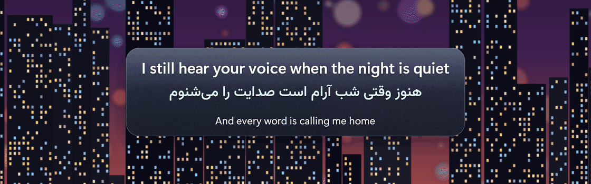
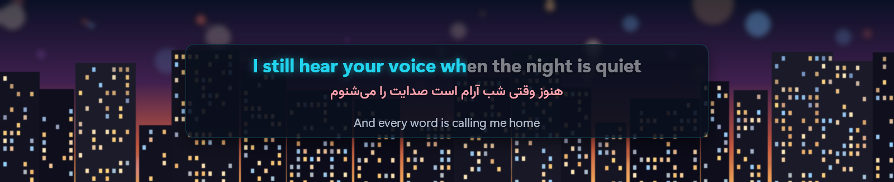
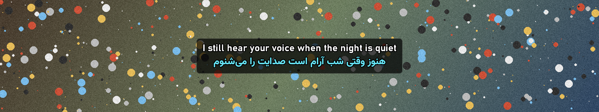
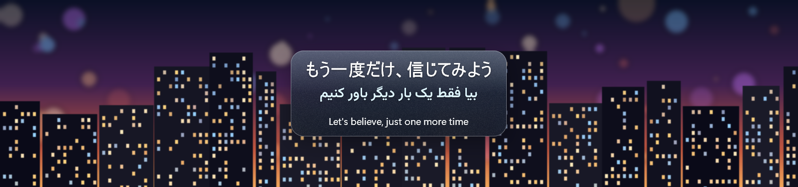
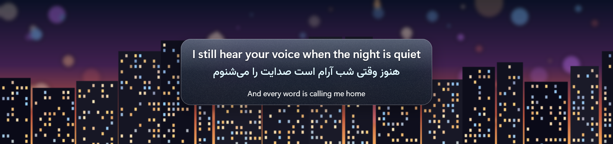
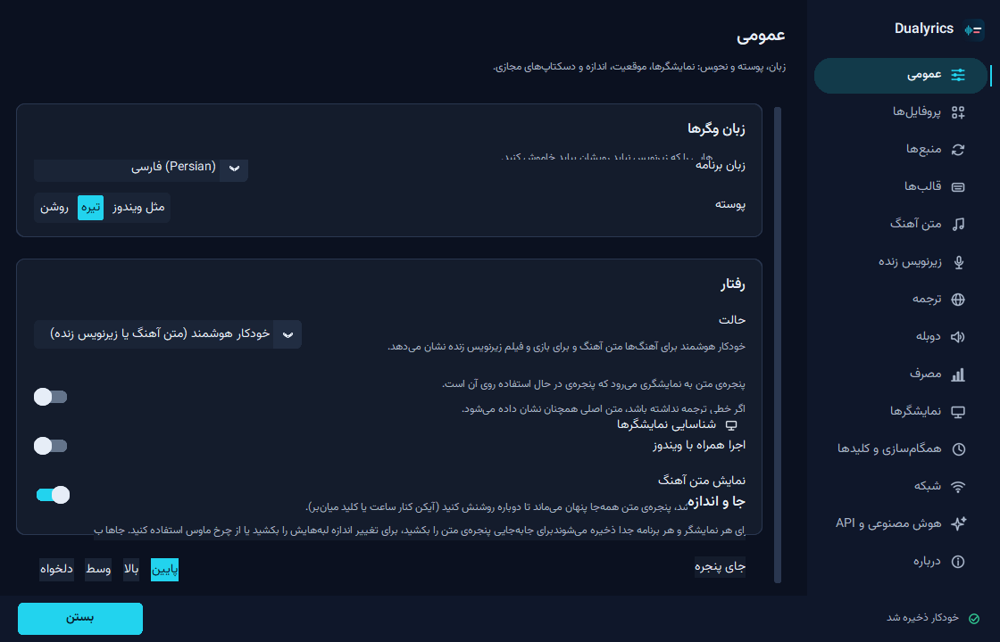

<div dir="rtl">

<p align="center"></p>

<h1 align="center">Dualyrics</h1>

<p align="center"><b>زیرنویس ترجمه‌شده‌ی زنده برای هر چیزی که روی ویندوز می‌شنوید: آهنگ، یوتیوب، بازی و فیلم.</b><br>
هر زبانی که بشنوید ← انگلیسی + زبان خودتان. بیش از ۴۰ زبان مقصد.</p>

<p align="center">
<a href="https://github.com/morpheusadam/Dualyrics/releases/latest"></a>
<a href="https://github.com/morpheusadam/Dualyrics/releases"></a>
<a href="https://github.com/morpheusadam/Dualyrics/stargazers"></a>
<a href="LICENSE"></a>

</p>

<p align="center">

</p>

<p align="center">
<a href="https://github.com/morpheusadam/Dualyrics/releases/latest"><b>دانلود برای ویندوز</b></a> ·
<a href="#شروع-سریع">شروع سریع</a> ·
<a href="#پرسشهای-رایج">پرسش‌های رایج</a> ·
<a href="README.md">English</a>
</p>

اگر Dualyrics کمکتان کرد یک آهنگ، ویدیو یا بازی را بفهمید، لطفاً به مخزن **ستاره** بدهید. ستاره‌ها به دیده شدن برنامه کمک می‌کنند و رأی شما برای [نسخه‌ی لینوکس](#نقشهی-راه) هم حساب می‌شوند.

## Dualyrics چیست؟

Dualyrics یک برنامه‌ی رایگان و متن‌باز برای ویندوز ۱۰ و ۱۱ است که زیر هر چیزی که گوش می‌دهید، در یک نوار زیرنویس کوچک و همیشه‌رو، ترجمه‌اش را می‌نویسد. برای آهنگ، متن زمان‌بندی‌شده را از [LRCLIB](https://lrclib.net) خط به خط و هم‌زمان با موسیقی نشان می‌دهد و ترجمه را زیر هر خط می‌گذارد. برای یوتیوب، فیلم و بازی، زیرنویسی را که خود برنامه روی صفحه نشان می‌دهد می‌خواند، یا به صدا گوش می‌دهد و با تشخیص گفتار آفلاین (Whisper) زیرنویس می‌سازد. گفتار یا متن به هر زبانی اول به انگلیسی و بعد به زبان شما برگردانده می‌شود؛ پس انیمه‌ی ژاپنی، بازی آلمانی یا آهنگ کره‌ای به فارسی، ترکی، اسپانیایی یا هر کدام از ۴۶ زبان مقصد می‌رسد. ترجمه با Google Gemini و کلید رایگان خودتان انجام می‌شود، یا بدون هیچ کلیدی با Google Translate رایگان. حساب کاربری، ورود و ارسال آمار ندارد.

## شروع سریع

1. فایل `Dualyrics-Setup-2.1.0.exe` را از [آخرین نسخه](https://github.com/morpheusadam/Dualyrics/releases/latest) دانلود و اجرا کنید. نصب‌کننده فارسی و انگلیسی دارد، دسترسی مدیر نمی‌خواهد و فقط برای کاربر ویندوز شما در `%LOCALAPPDATA%\Programs\Dualyrics` نصب می‌شود.
2. در پایان نصب، Dualyrics باز می‌شود و بار اول پنجره‌ی تنظیمات را نشان می‌دهد.
3. زبانتان را در **تنظیمات › عمومی › ترجمه به زبان** انتخاب کنید و یک آهنگ در اسپاتیفای یا یک ویدیو در یوتیوب پخش کنید.

برای متن آهنگ و زیرنویس روی صفحه همین کافی است. برای ساختن زیرنویس از روی خود صدا (بازی‌ها و ویدیوهای بی‌زیرنویس)، یک بار [زیرنویس زنده](#زیرنویس-زنده) را نصب کنید.

نسخه‌ی قابل‌حمل هم هست: `Dualyrics.exe` (یک فایل، بدون نصب) و `Dualyrics-2.1.0-windows-x64.zip`. فایل `SHA256SUMS.txt` چک‌سام همه‌ی فایل‌ها را دارد. اگر SmartScreen ویندوز درباره‌ی برنامه‌ی بدون امضا هشدار داد و به دانلود اعتماد دارید، **More info › Run anyway** را بزنید.

برای به‌روزرسانی، نصب‌کننده‌ی جدید را روی نسخه‌ی قبلی اجرا کنید؛ تنظیمات می‌مانند. حذف از **تنظیمات ویندوز › Apps › Installed apps › Dualyrics** انجام می‌شود و حذف‌کننده می‌پرسد تنظیمات هم پاک شوند یا نه (پیش‌فرض: می‌مانند).

## گرفتن کلید رایگان Gemini

Dualyrics بدون کلید هم کار می‌کند (با Google Translate رایگان). کلید Gemini ترجمه‌ی بهتری برای اصطلاح‌ها، زبان محاوره و بازی با کلمات می‌دهد، چون Gemini کل آهنگ (یا چند خط آخر زیرنویس) را یک‌جا می‌بیند. کلید رایگان است:

1. صفحه‌ی [Google AI Studio › API keys](https://aistudio.google.com/apikey) را باز کنید و با حساب گوگل وارد شوید.
2. روی **Create API key** بزنید. یک پروژه‌ی Google Cloud انتخاب کنید یا بگذارید AI Studio خودش بسازد.
3. کلید را کپی کنید (با `AIza` شروع می‌شود).
4. در Dualyrics به **تنظیمات › ترجمه** بروید، **سرویس ترجمه** را روی **Gemini** بگذارید، کلید را در کادر کلیدها بچسبانید و **آزمایش** را بزنید.

سطح رایگان برای هر مدل سقف درخواست روزانه دارد که گوگل تعیین و گاهی عوض می‌کند. هر آهنگ معمولاً یک درخواست است، ترجمه‌ها ذخیره می‌شوند و آهنگ‌هایی که از قبل به زبان شما هستند ترجمه نمی‌شوند. می‌توانید چند کلید و مدل اضافه کنید؛ وقتی یکی به سقف رسید، بعدی استفاده می‌شود و با گزینه‌ی **اگر Gemini کار نکرد از مترجم رایگان استفاده شود**، Google Translate جایش را می‌گیرد. کلیدها با DPAPI ویندوز برای کاربر شما رمز می‌شوند. صفحه‌ی **تنظیمات › مصرف** نشان می‌دهد چقدر از سقف روزانه را مصرف کرده‌اید.

## کاربردها

### موسیقی: اسپاتیفای، یوتیوب موزیک، Spotube

آهنگ را پخش کنید؛ Dualyrics خط فعلی، ترجمه‌اش و خط بعدی را هم‌زمان با موسیقی نشان می‌دهد. آهنگ را از کنترل‌های رسانه‌ی ویندوز می‌خواند، پس با اسپاتیفای دسکتاپ، Spotube، Media Player ویندوز و یوتیوب یا یوتیوب موزیک در Chrome، Edge، Firefox، Brave و Opera کار می‌کند. اگر متن زودتر یا دیرتر بود، با `Ctrl+Alt+Up` و `Ctrl+Alt+Down` تنظیمش کنید؛ برای هر آهنگ به خاطر سپرده می‌شود.

<p align="center"></p>

### یوتیوب و ویدیو در مرورگر

برای موزیک‌ویدیو، متن همگام جست‌وجو می‌شود؛ اما در مرورگر فقط تطابق دقیق (عنوان، خواننده و مدت با چند ثانیه اختلاف) پذیرفته می‌شود تا ویدیوی آشپزی «Pasta» متن آهنگی به همین نام را نگیرد. برای ویدیوهای دیگر، زیرنویسی که پخش‌کننده نشان می‌دهد خوانده می‌شود؛ در Chrome و Edge متن زیرنویس یوتیوب مستقیم و بدون OCR از راه UI Automation ویندوز خوانده می‌شود. اگر ویدیو زیرنویس نداشت، زیرنویس زنده از روی صدا می‌سازد.

### بازی

خیلی از بازی‌ها زیرنویس خودشان را دارند. Dualyrics آن را با OCR آفلاینِ خود ویندوز از روی صفحه می‌خواند: یک بار دور ناحیه‌ی زیرنویس مستطیل بکشید (**تنظیمات › منبع‌ها › انتخاب روی پنجره…**) تا فقط همان ناحیه، فقط وقتی عوض می‌شود، خوانده شود؛ متن‌هایی که هیچ‌وقت عوض نمی‌شوند (مثل HUD) نادیده گرفته می‌شوند. اگر بازی زیرنویس نداشت، زیرنویس زنده به صدای بازی گوش می‌دهد. در پروفایل **بازی‌ها** کلیک از روی زیرنویس رد می‌شود تا بازی مختل نشود. بازی را در حالت Borderless یا Windowed اجرا کنید.

<p align="center"></p>

### فیلم و سریال

در VLC، MPC-HC/BE، PotPlayer یا مرورگر، Dualyrics زیرنویس خود فیلم را از روی صفحه ترجمه می‌کند یا از گفت‌وگوها زیرنویس می‌سازد. هر خط همراه چند خط قبلی ترجمه می‌شود تا نام‌ها و اصطلاح‌ها در کل فیلم یکسان بمانند.

## Dualyrics چطور منبع را انتخاب می‌کند

برای برنامه‌ای که جلوی شماست، اول خط‌هایی استفاده می‌شود که خود برنامه دارد و فقط وقتی چیزی نبود، به صدا گوش داده می‌شود. سه منبع به ترتیب امتحان می‌شوند و اولین منبعی که چیزی دارد نمایش داده می‌شود:

| ترتیب | منبع | برای | روش |
|---|---|---|---|
| ۱ | متن هم‌زمان آهنگ | آهنگ در اسپاتیفای، Spotube، برنامه‌های موسیقی و مرورگر | جست‌وجو در LRCLIB با عنوان، خواننده، آلبوم و مدت؛ در مرورگر فقط تطابق دقیق |
| ۲ | زیرنویس روی صفحه | زیرنویس یوتیوب، فیلم و بازی | UI Automation ویندوز برای پخش‌کننده‌های وب در Chrome و Edge، وگرنه OCR آفلاین ویندوز روی ناحیه‌ی زیرنویس، ۱ تا ۶ بار در ثانیه |
| ۳ | صدا (زیرنویس زنده) | هر چیزی بدون متن یا زیرنویس | صدای بلندگو در مکث‌ها بریده و با Whisper آفلاین تشخیص داده می‌شود |

ترتیب و روشن یا خاموش بودن هر منبع را، برای همه‌ی برنامه‌ها یا برای یک پروفایل، در **تنظیمات › منبع‌ها** تغییر دهید. جدول کامل تصمیم در [docs/ALGORITHM.md](docs/ALGORITHM.md) است.

## هر زبانی، به انگلیسی و زبان شما

با **ترجمه از راه انگلیسی** (پیش‌فرض روشن)، گفتار و متن هر زبانی از انگلیسی عبور می‌کند: مدل چندزبانه‌ی Whisper گفتار را روی کامپیوتر شما به انگلیسی برمی‌گرداند و متن روی صفحه را مترجم به انگلیسی می‌برد؛ بعد انگلیسی به زبان مقصد شما ترجمه می‌شود. با **خط زبان اصلی هم نشان داده شود**، خط به همان زبانی که گفته شده دیده می‌شود و انگلیسی به‌صورت خط سوم کوچک زیر ترجمه می‌آید.

<p align="center"></p>

زبان مقصد می‌تواند هر یک از ۴۶ زبان باشد؛ از جمله فارسی، عربی، ترکی، اسپانیایی، فرانسوی، آلمانی، روسی، هندی، اردو، ژاپنی، کره‌ای و چینی. فارسی، عربی، عبری، اردو، کردی سورانی و پشتو راست‌به‌چپ چیده می‌شوند و حروف را خود ویندوز به هم می‌چسباند. فونت وزیرمتن همراه برنامه است.

## زیرنویس زنده

زیرنویس زنده هر صدایی را که از بلندگو پخش می‌شود به زیرنویس تبدیل می‌کند: صدای خروجی ضبط می‌شود، در مکث‌های طبیعی بریده می‌شود، با [faster-whisper](https://github.com/SYSTRAN/faster-whisper) روی کارت گرافیک NVIDIA یا CPU تشخیص داده می‌شود و ترجمه کمی بعد نمایش داده می‌شود. خطاهای رایج Whisper، مثل «Thank you for watching» در سکوت یا موسیقی، حذف می‌شوند.

بسته‌های گفتار (حدود ۱۵۰ مگابایت، یا حدود ۱ گیگابایت بیشتر با پشتیبانی NVIDIA) داخل فایل exe نیستند تا برنامه حدود ۲۵ مگابایت بماند و سریع باز شود. برای نصب:

1. در **تنظیمات › زیرنویس زنده**، **نصب زیرنویس زنده** را بزنید (اگر کارت NVIDIA دارید، گزینه‌اش را تیک بزنید). برنامه‌ی نصب‌شده بسته‌ها را در `%APPDATA%\Dualyrics\live-runtime` می‌گذارد و فقط برای همین دانلود یک بار به [Python 3.12](https://www.python.org/downloads/) روی کامپیوتر نیاز دارد.
2. مدل گفتار را انتخاب کنید: `small` پیش‌فرض خوبی است، `tiny` و `base` سبک‌ترند و `medium` کارت گرافیک می‌خواهد. برای بازی و فیلم انگلیسی **مدل فقط انگلیسی** را روشن کنید. مدل بار اول در `%APPDATA%\Dualyrics\models` دانلود می‌شود.

در حالت خودکار هوشمند، زیرنویس زنده برای بازی‌های تمام‌صفحه، برنامه‌هایی که به‌عنوان بازی اضافه شده‌اند و آهنگ یا ویدیوی بی‌متن و بی‌زیرنویس خودش شروع می‌شود. توقف موقت: `Ctrl+Alt+P`.

## قالب‌ها

هر قالب یک فایل JSON است که کل ظاهر را تعیین می‌کند: فونت هر خط، رنگ یا گرادیان، دورخط، تا چهار سایه یا درخشش نرم، کادر، ترتیب خط‌ها، کارائوکه و حرکت. نُه قالب آماده هست: **شیشه‌ی مایع** (پیش‌فرض)، Cinema، Netflix، Karaoke، Minimal، Neon، Game HUD، Glass و Persian Classic. شیشه‌ی مایع پشت کادر را واقعاً با افکت acrylic ویندوز تار می‌کند و لبه‌ی براق و عمق نرم دارد.

<p align="center"></p>

هر قالب را در **تنظیمات › قالب‌ها** با پیش‌نمایش زنده روی صحنه‌ی تیره، روشن و شلوغ بازی و بررسی کنتراست ویرایش کنید. ویرایش قالب آماده یک نسخه‌ی شخصی می‌سازد و **بازگشت به حالت اولیه‌ی قالب** همیشه کار می‌کند. قالب‌ها را می‌شود تکثیر، تغییر نام، حذف (با امکان برگرداندن)، و به‌صورت `.json` صادر یا وارد کرد.

<p align="center"></p>

## پروفایل هر برنامه

هر برنامه می‌تواند حالت (خودکار هوشمند، متن آهنگ، زنده یا خاموش)، قالب، زبان مقصد، ترتیب منبع‌ها، ناحیه‌ی زیرنویس، نمایشگر، جا، عرض، رد شدن کلیک، فقط ترجمه و تنظیمات دوبله‌ی خودش را داشته باشد. پروفایل اسپاتیفای، Spotube، برنامه‌های موسیقی، مرورگرها، VLC، MPC-HC/BE و PotPlayer آماده است، به‌علاوه‌ی پیش‌تنظیم **بازی‌ها** برای برنامه‌های تمام‌صفحه. برنامه را از بین برنامه‌های در حال اجرا، با انتخاب فایل `.exe` یا با کلیک روی پنجره‌اش اضافه کنید.

## نمایشگرها و پنجره‌ی زیرنویس

زیرنویس را بکشید تا جابه‌جا شود، لبه‌ی چپ یا راست را بکشید تا متن دوباره چیده شود، لبه‌ی بالا یا پایین یا گوشه را بکشید تا بزرگ و کوچک شود، یا از چرخ ماوس استفاده کنید. جا و اندازه برای هر نمایشگر و هر برنامه به خاطر سپرده می‌شود. می‌توانید نمایشگرهای مجاز را انتخاب کنید، زیرنویس را دنبال نمایشگر برنامه‌ی فعال بفرستید یا از منوی راست‌کلیک به نمایشگر دیگری ببرید. `Ctrl+Alt+K` رد شدن کلیک را خاموش و روشن می‌کند.

<p align="center"></p>

## دوبله

دوبله ترجمه را با صدا می‌خواند. پیش‌فرض خاموش است؛ از **تنظیمات › دوبله**، منوی نوار وظیفه، منوی زیرنویس یا `Ctrl+Alt+D` روشنش کنید. خط‌های آهنگ از قبل آماده می‌شوند و هم‌زمان با خود خط شروع می‌شوند؛ زیرنویس‌ها وقتی دیگر تغییر نکنند خوانده می‌شوند. وقتی صدای دوبله پخش می‌شود، صدای برنامه‌های دیگر کم می‌شود (پیش‌فرض ۶۰٪) و بعد برمی‌گردد.

| موتور صدا | هزینه | توضیح |
|---|---|---|
| صداهای Gemini | سطح رایگان کلید Gemini | تبدیل متن به گفتار با مدل‌های `*-tts` |
| Gemini Live | سطح رایگان کلید Gemini | صدا به صدا برای بازی و فیلم: صدای ضبط‌شده به Gemini می‌رود و ترجمه با کمترین تأخیر خوانده می‌شود |
| صداهای Microsoft Edge | رایگان، آنلاین | نیاز به بسته‌ی کوچک `edge-tts`، نصب با یک کلیک |
| Piper | رایگان، آفلاین | حدود ۲۰ مگابایت به‌علاوه‌ی ۲۰ تا ۶۰ مگابایت برای هر صدا، نصب با یک کلیک |

## شمارنده‌ی مصرف Gemini

**تنظیمات › مصرف** هر درخواست Gemini را می‌شمارد (ترجمه، دوبله و Gemini Live): تعداد درخواست، توکن، ثانیه‌های صدا، خطای سقف مصرف و ترجمه‌هایی که از حافظه آمده‌اند؛ برای هر روز، مدل، کلید و آهنگ یا ویدیو. سهم امروز از سقف روزانه‌ی هر مدل و زمان ریست شدن سهمیه (نیمه‌شب به وقت اقیانوس آرام) را نشان می‌دهد و در ۸۰٪ هشدار می‌دهد. کلیدها فقط با شماره (#1، #2) نام برده می‌شوند. داده‌ها در `%APPDATA%\Dualyrics\usage.sqlite` می‌مانند و به CSV صادر می‌شوند.

## دستیار هوش مصنوعی و MCP

Claude Desktop، Claude Code و دستیارهای دیگری که پروتکل MCP را می‌فهمند می‌توانند Dualyrics را بخوانند و تنظیم کنند؛ مثلاً «قالب Game HUD را برای God of War بگذار»، «به ترکی ترجمه کن» یا «مصرف Gemini من را نشان بده». سرور MCP داخل خود برنامه است: `Dualyrics.exe --mcp`. متن آماده‌ی تنظیم با دکمه‌ی کپی در **تنظیمات › هوش مصنوعی و API** هست. برای Claude Desktop (فایل `claude_desktop_config.json`) و Claude Code:

</div>

```json
{
  "mcpServers": {
    "dualyrics": {
      "command": "C:\\Users\\<you>\\AppData\\Local\\Programs\\Dualyrics\\Dualyrics.exe",
      "args": ["--mcp"]
    }
  }
}
```

```powershell
claude mcp add dualyrics --scope user -- "C:\Users\<you>\AppData\Local\Programs\Dualyrics\Dualyrics.exe" --mcp
```

<div dir="rtl">

ابزارها از طریق یک API محلی با برنامه‌ی در حال اجرا حرف می‌زنند که فقط روی `127.0.0.1` و با توکن داخل `%APPDATA%\Dualyrics\api.json` کار می‌کند. صفحه‌های وب به آن دسترسی ندارند و دستیارها هیچ‌وقت کلیدهای Gemini شما را نمی‌بینند. جزئیات: [docs/AI.md](docs/AI.md).

## حریم خصوصی

Dualyrics حساب کاربری، ارسال آمار، تحلیل و بررسی خودکار به‌روزرسانی ندارد. تشخیص گفتار و OCR روی کامپیوتر شما انجام می‌شود. فقط این درخواست‌ها، از راه پروکسی‌ای که انتخاب می‌کنید، فرستاده می‌شوند:

| سرویس | چه چیزی فرستاده می‌شود | چه زمانی |
|---|---|---|
| LRCLIB | عنوان، خواننده، آلبوم و مدت آهنگ | برای پیدا کردن متن آهنگ جدید |
| Google Gemini | خط‌های آهنگ یا زیرنویس، عنوان آهنگ یا نام برنامه، چند خط قبلی، زبان مقصد، متن سبک ترجمه و کلید API | وقتی سرویس ترجمه Gemini است و خط در حافظه نیست |
| Google Translate | خط‌های آهنگ یا زیرنویس و زبان مقصد | در حالت رایگان یا به‌عنوان جایگزین |
| Google Gemini (دوبله) | خط‌های ترجمه‌شده برای خواندن؛ با Gemini Live، صدای ضبط‌شده‌ی بلندگو | فقط وقتی دوبله روشن است و موتور Gemini انتخاب شده |
| صداهای Microsoft Edge | خط‌های ترجمه‌شده برای خواندن | فقط وقتی دوبله با موتور Edge روشن است |
| Hugging Face، GitHub | دانلود مدل Whisper یا صدای Piper | یک بار، در اولین استفاده |
| PyPI | دانلود بسته‌های زیرنویس زنده یا صداهای Edge | فقط وقتی دکمه‌ی نصب را می‌زنید |

بقیه‌ی داده‌ها در `%APPDATA%\Dualyrics` می‌ماند. تصویری که برای OCR از صفحه گرفته می‌شود هیچ‌وقت از کامپیوتر شما خارج نمی‌شود.

## پرسش‌های رایج

### چطور زیرنویس بازی را هم‌زمان روی کامپیوتر ترجمه کنم؟

Dualyrics را نصب کنید، به **تنظیمات › منبع‌ها** بروید، **انتخاب روی پنجره…** را بزنید و دور ناحیه‌ی زیرنویس بازی مستطیل بکشید. از آن به بعد هر بار که آن ناحیه عوض شود، با OCR آفلاین ویندوز خوانده می‌شود و ترجمه روی بازی نمایش داده می‌شود. اگر بازی زیرنویس ندارد، زیرنویس زنده را یک بار نصب کنید تا از صدای بازی زیرنویس ترجمه‌شده بسازد.

### چطور یک ویدیوی یوتیوب را از هر زبانی ترجمه کنم؟

ویدیو را در Chrome یا Edge پخش کنید. اگر یوتیوب زیرنویس نشان می‌دهد (حتی زیرنویس خودکار)، Dualyrics آن را می‌خواند و هر خط را به زبان شما ترجمه می‌کند. اگر زیرنویس نیست، زیرنویس زنده از روی صدا می‌سازد. با ترجمه از راه انگلیسی، ویدیوی ژاپنی، کره‌ای، هندی یا هر زبانی که Whisper بشناسد اول به انگلیسی و بعد به زبان شما برمی‌گردد.

### چطور ترجمه‌ی متن آهنگ‌های اسپاتیفای را ببینم؟

آهنگ را در اسپاتیفای دسکتاپ پخش کنید. اسپاتیفای آهنگ را به کنترل‌های رسانه‌ی ویندوز گزارش می‌دهد و Dualyrics متن همگام را از LRCLIB در پنجره‌ی خودش با ترجمه زیر هر خط نشان می‌دهد. به ورود به هیچ حسابی نیاز نیست.

### آیا Dualyrics رایگان است؟ کلید API لازم است؟

Dualyrics رایگان و با مجوز MIT است. کلید لازم نیست، چون مترجم پیش‌فرض Google Translate رایگان است. کلید Gemini اختیاری است و تا سقف روزانه‌ی گوگل رایگان است.

### آیا زیرنویس زنده صدای من را به اینترنت می‌فرستد؟

نه. تشخیص گفتار آفلاین است و فقط متن تشخیص‌داده‌شده برای ترجمه فرستاده می‌شود. تنها قابلیتی که صدا می‌فرستد دوبله با موتور Gemini Live است که پیش‌فرض خاموش است.

### روی مک یا لینوکس کار می‌کند؟

هنوز نه. نسخه‌ی لینوکس در [نقشه‌ی راه](#نقشهی-راه) است و ستاره‌ها درباره‌اش تصمیم می‌گیرند.

## نقشه‌ی راه

- **نسخه‌ی لینوکس: ستاره‌ها را در ۱۷ دسامبر ۲۰۲۶ بررسی می‌کنیم؛ هر ستاره یک رأی است.** اگر مخزن تا آن موقع به اندازه‌ی کافی رشد کرده باشد، نسخه‌ی لینوکس قدم بعدی است. اگر آن را می‌خواهید، [به Dualyrics ستاره بدهید](https://github.com/morpheusadam/Dualyrics/stargazers).
- زبان‌های بیشتر برای رابط برنامه (ترجمه‌ها پذیرفته می‌شوند).
- کارائوکه‌ی کلمه به کلمه برای متن‌هایی که زمان‌بندی کلمه دارند.
- ایده‌ی خودتان را در یک [درخواست قابلیت](https://github.com/morpheusadam/Dualyrics/issues/new/choose) بنویسید.

## مشارکت

گزارش خطا، ترجمه‌ی رابط، قالب جدید و pull request پذیرفته می‌شود. [CONTRIBUTING.md](CONTRIBUTING.md) را بخوانید یا یکی از [کارهای مناسب شروع](docs/GOOD_FIRST_ISSUES.md) را بردارید. لطفاً [آیین‌نامه‌ی رفتاری](CODE_OF_CONDUCT.md) را رعایت کنید و مشکلات امنیتی را طبق [SECURITY.md](SECURITY.md) به‌صورت خصوصی گزارش دهید. جدول کامل تنظیمات و عیب‌یابی در [README انگلیسی](README.md#configuration) است.

## مجوز

[MIT](LICENSE). Copyright (c) 2026 [morpheusadam](https://github.com/morpheusadam) و مشارکت‌کنندگان Dualyrics.

ساخته‌ی [morpheusadam](https://github.com/morpheusadam). اگر Dualyrics به کارتان آمد، یک [ستاره](https://github.com/morpheusadam/Dualyrics/stargazers) بهترین تشکر است.

</div>
