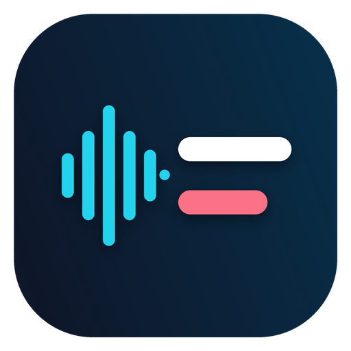
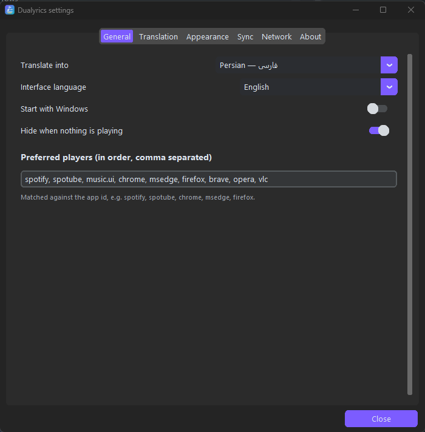

<div dir="rtl">

<p align="center"></p>

<h1 align="center">Dualyrics</h1>

<p align="center"><b>متن همگام آهنگ با ترجمه زیر هر خط، در یک پنجره شناور روی ویندوز.</b><br>
برای Spotify، Spotube، یوتیوب موزیک، یوتیوب در مرورگر و هر پخش‌کننده‌ای که در کنترل‌های رسانه ویندوز دیده می‌شود.</p>

<p align="center">
<a href="../../releases/latest"></a>

<a href="LICENSE"></a>
</p>

<p align="center">

</p>

<p align="center"><a href="README.md">English</a></p>

## Dualyrics چیست؟

Dualyrics یک برنامه رایگان و متن‌باز برای ویندوز ۱۰ و ۱۱ است که متن آهنگی را که پخش می‌کنید، خط به خط و هم‌زمان با موسیقی نشان می‌دهد و زیر هر خط ترجمه‌اش را می‌نویسد. آهنگ در حال پخش را از کنترل‌های رسانه ویندوز می‌خواند، متن زمان‌بندی‌شده را از [LRCLIB](https://lrclib.net) می‌گیرد، کل آهنگ را یک‌جا با Google Gemini (با کلید رایگان خودتان) یا با Google Translate رایگان (بدون کلید) ترجمه می‌کند و یک نوار کوچک همیشه‌رو، بالای پنجره‌های دیگر نشان می‌دهد. با اسپاتیفای دسکتاپ، Spotube و یوتیوب یا یوتیوب موزیک در Chrome، Edge، Firefox، Brave و Opera کار می‌کند و به حساب اسپاتیفای یا هیچ ورودی نیاز ندارد.

## امکانات

- متن همگام از LRCLIB: خطی که خوانده می‌شود، ترجمه‌اش، و خط بعدی به رنگ خاکستری. متن‌هایی که زمان‌بندی ندارند به شکل فهرست قابل اسکرول نمایش داده می‌شوند.
- ترجمه به ۴۶ زبان. Gemini کل آهنگ را یک‌جا می‌گیرد، پس اصطلاح‌ها، زبان عامیانه و بازی‌های کلامی با توجه به کل آهنگ ترجمه می‌شوند. حالت رایگان Google Translate کلید لازم ندارد.
- چینش راست‌به‌چپ برای فارسی، عربی، عبری، اردو، کردی سورانی و پشتو. اگر فونت Vazirmatn نصب باشد، خودکار استفاده می‌شود.
- آهنگ‌هایی که از قبل به زبان مقصد هستند ترجمه نمی‌شوند تا سهمیه Gemini هدر نرود.
- چند کلید و چند مدل Gemini. وقتی سهمیه یکی تمام شود، سراغ بعدی می‌رود و در صورت نیاز از مترجم رایگان استفاده می‌کند.
- پنجره کاملاً قابل تنظیم: فونت، اندازه، ضخامت، رنگ‌ها، رنگ و شفافیت پس‌زمینه، حالت «فقط متن» با پس‌زمینه شفاف و حاشیه و سایه، عرض، چینش، گوشه‌های گرد (ویندوز ۱۱)، جای بالا/وسط/پایین، قفل جای پنجره و عبور کلیک.
- تنظیم هم‌زمانی: تأخیر کلی، تأخیر جداگانه برای هر آهنگ که ذخیره می‌شود، و کلیدهای میان‌بر سراسری قابل تغییر (`Ctrl+Alt+Up`، `Ctrl+Alt+Down`، `Ctrl+Alt+L`).
- آیکن در سینی ویندوز (کنار ساعت)، اجرای اختیاری همراه با ویندوز، و به خاطر سپردن جای پنجره برای هر مانیتور.
- پشتیبانی از پراکسی برای LRCLIB و ترجمه: بدون پراکسی، پراکسی سیستم، یا پراکسی دلخواه `http://` و `socks5://` با دکمه آزمایش اتصال.
- رابط کاربری انگلیسی و فارسی.
- بدون حساب کاربری و بدون ارسال آمار. تنظیمات، کش و لاگ در `%APPDATA%\Dualyrics` می‌ماند و کلیدهای Gemini با DPAPI ویندوز برای کاربر شما رمزگذاری می‌شوند.

<p align="center">

</p>

## شروع سریع

### دانلود برنامه

1. فایل `Dualyrics.exe` را از [آخرین نسخه (Releases)](../../releases/latest) دانلود کنید. همین فایل همراه README و مجوز در `Dualyrics-<version>-windows-x64.zip` هم هست و با `SHA256SUMS.txt` می‌توانید درستی فایل دانلودشده را بررسی کنید.
2. اجرایش کنید. یک فایل تکی و قابل‌حمل است و نصب لازم ندارد. بار اول پنجره تنظیمات باز می‌شود.
3. در **General › Translate into** (عمومی › ترجمه به زبان) زبان را انتخاب کنید و یک آهنگ پخش کنید.

ممکن است SmartScreen ویندوز درباره برنامه امضانشده هشدار بدهد. اگر به فایل اعتماد دارید **More info › Run anyway** را بزنید، یا برنامه را از سورس اجرا کنید.

### اجرا از سورس

نیازها: ویندوز ۱۰ یا ۱۱ و Python 3.10 یا جدیدتر.

<div dir="ltr">

```powershell
git clone <repository-url> Dualyrics
cd Dualyrics
python -m venv .venv
.venv\Scripts\pip install -r requirements.txt
.venv\Scripts\pythonw run.pyw
```

</div>

گزینه‌های خط فرمان: `--settings` پنجره تنظیمات را باز می‌کند، `--debug` لاگ کامل می‌نویسد و `--version` نسخه را نشان می‌دهد. اگر برنامه را دوباره اجرا کنید، پنجره تنظیمات همان نسخه در حال اجرا باز می‌شود.

### ساختن فایل exe

<div dir="ltr">

```powershell
.venv\Scripts\pip install -r requirements-build.txt
powershell -ExecutionPolicy Bypass -File tools\build.ps1
```

</div>

`tools\build.ps1` اول تست‌ها را اجرا می‌کند و بعد PyInstaller را با `Dualyrics.spec`. خروجی آن `dist\Dualyrics.exe`، `dist\Dualyrics-<version>-windows-x64.zip` و `dist\SHA256SUMS.txt` است. با push کردن تگ `v*` همین ساخت روی GitHub Actions انجام می‌شود و این فایل‌ها به یک GitHub Release اضافه می‌شوند. تغییرات هر نسخه در [CHANGELOG.md](CHANGELOG.md) آمده است.

### گرفتن کلید رایگان Gemini (اختیاری، ترجمه بهتر)

1. وارد [Google AI Studio](https://aistudio.google.com/) شوید و **Get API key** را بزنید.
2. در **تنظیمات › ترجمه**، گزینه **Gemini** را انتخاب کنید، کلید را بچسبانید و **آزمایش** را بزنید.

بدون کلید، Dualyrics از Google Translate رایگان استفاده می‌کند.

## کار با پنجره

| کار | نتیجه |
|---|---|
| کشیدن با ماوس | جابه‌جا کردن نوار (اگر قفل نباشد) |
| چرخ ماوس | بزرگ و کوچک کردن متن. روی متن بدون زمان‌بندی اسکرول می‌کند و `Ctrl` + چرخ اندازه را عوض می‌کند |
| دوبار کلیک | نمایش یا پنهان کردن خط بعدی |
| کلیک راست | منو: تنظیمات، ترجمه دوباره، تأخیر آهنگ، نمایش متن اصلی/ترجمه/خط بعدی، فقط متن، قفل، عبور کلیک، جای پنجره، پنهان کردن، خروج |
| آیکن سینی ویندوز | نمایش متن، تنظیمات، ترجمه دوباره، عبور کلیک، قفل جای پنجره، باز کردن پوشه کش، خروج. کلیک چپ تنظیمات را باز می‌کند |

وقتی «عبور کلیک» روشن است، نوار به ماوس واکنش نشان نمی‌دهد. برای خاموش کردنش از آیکن سینی ویندوز استفاده کنید.

<p align="center">


</p>

## تنظیمات

هر تغییری فوراً اعمال می‌شود. پنجره تنظیمات شش زبانه دارد: عمومی، ترجمه، ظاهر، همگام‌سازی، شبکه و درباره. تنظیمات در `%APPDATA%\Dualyrics\settings.json` ذخیره می‌شود. با متغیر محیطی `DUALYRICS_HOME` می‌توانید همه داده‌ها را در پوشه دیگری نگه دارید (نسخه قابل حمل).

| زبانه | گزینه‌ها |
|---|---|
| عمومی | زبان ترجمه (۴۶ زبان)، زبان برنامه (انگلیسی/فارسی)، اجرا همراه با ویندوز، پنهان شدن وقتی چیزی پخش نمی‌شود، ترتیب پخش‌کننده‌های ترجیحی |
| ترجمه | سرویس ترجمه (Gemini یا رایگان)، کلیدها و مدل‌های Gemini با دکمه آزمایش، استفاده از مترجم رایگان وقتی Gemini کار نکرد، دستور سبک ترجمه، ترجمه نکردن آهنگ‌هایی که به زبان مقصدند، پاک کردن کش |
| ظاهر | فونت، اندازه و ضخامت متن اصلی و ترجمه، رنگ‌ها، رنگ و شفافیت پس‌زمینه، فقط متن، حاشیه و سایه، عرض، ارتفاع متن بدون زمان‌بندی، چینش، نمایش هر خط، گوشه گرد، جای پنجره، قفل، عبور کلیک |
| همگام‌سازی | تأخیر کلی، تأخیر همین آهنگ، گام تأخیر، کلیدهای میان‌بر سراسری |
| شبکه | بدون پراکسی، پراکسی سیستم یا پراکسی دلخواه، آزمایش اتصال |
| درباره | نسخه برنامه، باز کردن پوشه داده‌ها و لاگ |

فهرست کامل کلیدهای `settings.json` با مقدار پیش‌فرض در [README انگلیسی](README.md#configuration) آمده است.

## پخش‌کننده‌های پشتیبانی‌شده

هر برنامه‌ای که آهنگش در پنجره کنترل رسانه ویندوز (کنار پنجره صدا) دیده شود، کار می‌کند. این‌ها در فهرست پیش‌فرض هستند: اسپاتیفای دسکتاپ (`spotify`)، Spotube (`spotube`)، برنامه Media Player ویندوز (`zunemusic`)، یوتیوب و یوتیوب موزیک در Chrome (`chrome`)، Edge (`msedge`)، Firefox (`firefox`)، Brave و Opera، و VLC در نسخه‌هایی که به کنترل رسانه ویندوز گزارش می‌دهند (`vlc`).

## پرسش‌های رایج

### چطور ترجمه متن آهنگ را روی اسپاتیفای دسکتاپ ببینم؟

Dualyrics را نصب کنید، در **تنظیمات › عمومی › ترجمه به زبان** زبان را انتخاب کنید و در برنامه اسپاتیفای آهنگ پخش کنید. اسپاتیفای آهنگ را به کنترل‌های رسانه ویندوز گزارش می‌دهد و Dualyrics متن همگام را با ترجمه زیر هر خط، در پنجره خودش بالای اسپاتیفای نشان می‌دهد. لازم نیست وارد هیچ حسابی شوید.

### آیا می‌شود متن آهنگ‌های اسپاتیفای را به فارسی ترجمه کرد؟

بله. Dualyrics به ۴۶ زبان ترجمه می‌کند، از جمله فارسی، عربی، ترکی، اسپانیایی، آلمانی، فرانسوی و روسی. فارسی به شکل راست‌به‌چپ و با فونت مناسب نمایش داده می‌شود. برای ترجمه طبیعی‌تر یک کلید رایگان Gemini اضافه کنید؛ بدون کلید از Google Translate رایگان استفاده می‌شود.

### چطور برای یوتیوب موزیک در ویندوز متن همگام با ترجمه بگیرم؟

یوتیوب موزیک یا یک موزیک‌ویدیو در یوتیوب را در Chrome، Edge، Firefox، Brave یا Opera پخش کنید و Dualyrics را باز نگه دارید. مرورگر عنوان را به ویندوز می‌دهد، Dualyrics عنوان‌هایی مثل «Artist - Song (Official Video)» را تمیز می‌کند، متن همگام را از LRCLIB پیدا می‌کند و ترجمه را زیر هر خط نشان می‌دهد.

### برنامه رایگان است؟ کلید API لازم دارد؟

رایگان است و مجوز MIT دارد. کلید لازم نیست، چون مترجم پیش‌فرض Google Translate رایگان است. کلید Gemini اختیاری است و ترجمه اصطلاح‌ها و زبان عامیانه را بهتر می‌کند. سهمیه رایگان Gemini را گوگل تعیین می‌کند.

### روی مک یا لینوکس کار می‌کند؟

نه. Dualyrics از کنترل‌های رسانه، رجیستری و توابع پنجره ویندوز استفاده می‌کند و فقط روی ویندوز ۱۰ و ۱۱ اجرا می‌شود.

### متن زودتر یا دیرتر از آهنگ می‌آید. چطور درستش کنم؟

`Ctrl+Alt+Up` متن را دیرتر و `Ctrl+Alt+Down` زودتر می‌کند، به طور پیش‌فرض ۲۵۰ میلی‌ثانیه با هر بار زدن. این تأخیر برای همان آهنگ ذخیره می‌شود. تأخیر کلی برای همه آهنگ‌ها در **تنظیمات › همگام‌سازی** است.

## حریم خصوصی

Dualyrics حساب کاربری، ارسال آمار و بررسی خودکار به‌روزرسانی ندارد. فقط این درخواست‌ها را، از طریق پراکسی‌ای که انتخاب کرده‌اید، می‌فرستد:

| مقصد | چه چیزی فرستاده می‌شود | چه وقت |
|---|---|---|
| LRCLIB (`lrclib.net`) | نام آهنگ، خواننده، آلبوم و مدت آهنگ | برای پیدا کردن متن آهنگ جدید و برای آزمایش اتصال |
| Google Gemini (`generativelanguage.googleapis.com`) | خط‌های متن، نام آهنگ و خواننده، زبان مقصد، متن سبک ترجمه و کلید API شما | فقط وقتی سرویس Gemini انتخاب شده و آهنگ در کش نیست |
| Google Translate (`translate.googleapis.com`) | خط‌های متن و زبان مقصد | در حالت رایگان، یا وقتی Gemini کار نکند |

بقیه چیزها روی کامپیوتر خودتان در `%APPDATA%\Dualyrics` می‌ماند: `settings.json` (کلیدهای Gemini رمزگذاری‌شده با DPAPI)، پوشه `cache` (متن‌ها، ترجمه‌ها، تأخیر هر آهنگ) و `logs\dualyrics.log` (ممکن است نام آهنگ‌ها در آن باشد). برای پاک کردن کامل، «اجرا همراه با ویندوز» را خاموش کنید، از برنامه خارج شوید و این پوشه را حذف کنید.

حالت رایگان از یک آدرس غیررسمی Google Translate استفاده می‌کند که ممکن است محدود شود یا بدون اطلاع تغییر کند.

## رفع مشکل

| مشکل | راه‌حل |
|---|---|
| خطای شبکه یا پیدا نشدن هیچ متنی | در **تنظیمات › شبکه** دکمه **آزمایش اتصال** را بزنید. اگر LRCLIB یا گوگل در دسترس نیست، پراکسی تنظیم کنید |
| از یک برنامه پراکسی محلی استفاده می‌کنید (مثلاً کلاینت SOCKS5 روی `127.0.0.1`) | گزینه **دلخواه** را انتخاب کنید و `socks5://127.0.0.1:<port>` یا `http://127.0.0.1:<port>` را وارد کنید. اگر DNS هم باید از پراکسی رد شود `socks5h://` بنویسید. گزینه **پراکسی سیستم** از تنظیمات پراکسی ویندوز و متغیرهای `HTTP_PROXY`/`HTTPS_PROXY` استفاده می‌کند |
| «ترجمه انجام نشد (سهمیه، کلید یا اینترنت)» | در زبانه ترجمه **آزمایش** را بزنید. کلید یا مدل دیگری اضافه کنید یا مترجم رایگان را روشن کنید، بعد روی نوار کلیک راست کنید و **ترجمه‌ی دوباره‌ی این آهنگ** را بزنید |
| نوار آهنگ پخش‌کننده دیگری را نشان می‌دهد | پخش‌کننده خودتان را اول فهرست **پخش‌کننده‌های ترجیحی** بگذارید |
| هیچ چیزی نمایش داده نمی‌شود | ببینید آهنگ در پنجره کنترل رسانه ویندوز دیده می‌شود یا نه. اگر نه، آن پخش‌کننده به ویندوز گزارش نمی‌دهد |
| نوار به ماوس واکنش نمی‌دهد | «عبور کلیک» روشن است. از آیکن سینی ویندوز خاموشش کنید |
| کلید میان‌بر کار نمی‌کند | احتمالاً برنامه دیگری از آن استفاده می‌کند. در زبانه همگام‌سازی ترکیب دیگری بگذارید و **اعمال** را بزنید |
| مشکل دیگر | برنامه را با `--debug` اجرا کنید و لاگ را از **درباره › باز کردن لاگ** بخوانید |

## مشارکت

گزارش باگ، ترجمه رابط کاربری و Pull Request خوش‌آمد است. راهنما در [CONTRIBUTING.md](CONTRIBUTING.md) است.

## سپاس

- متن آهنگ‌ها از [LRCLIB](https://lrclib.net)، یک پایگاه داده آزاد و رایگان متن آهنگ. اگر می‌توانید از آن حمایت کنید و متن‌های جاافتاده را اضافه کنید.
- رابط کاربری با [CustomTkinter](https://github.com/TomSchimansky/CustomTkinter)، [pystray](https://github.com/moses-palmer/pystray) و Pillow ساخته شده است.

حق متن آهنگ‌ها متعلق به صاحبانشان است. Dualyrics فقط متنی را که از LRCLIB می‌گیرد روی کامپیوتر خودتان نمایش می‌دهد.

## مجوز

[MIT](LICENSE). Copyright (c) 2026 Dualyrics contributors.

</div>
