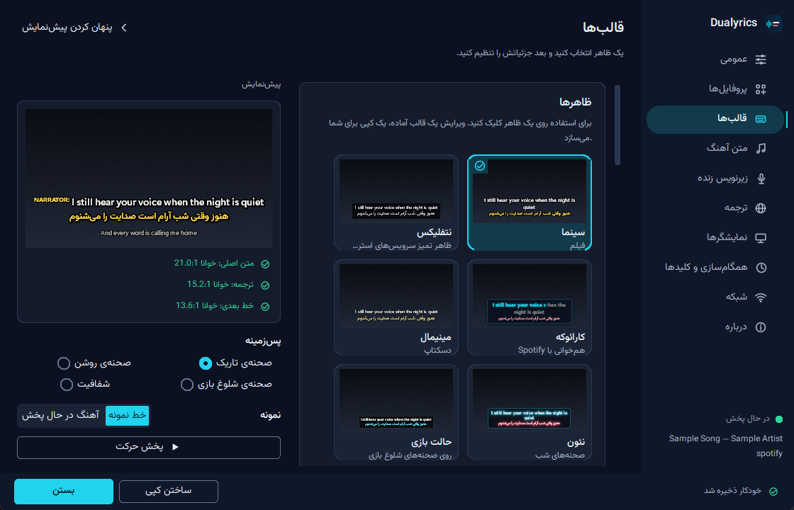
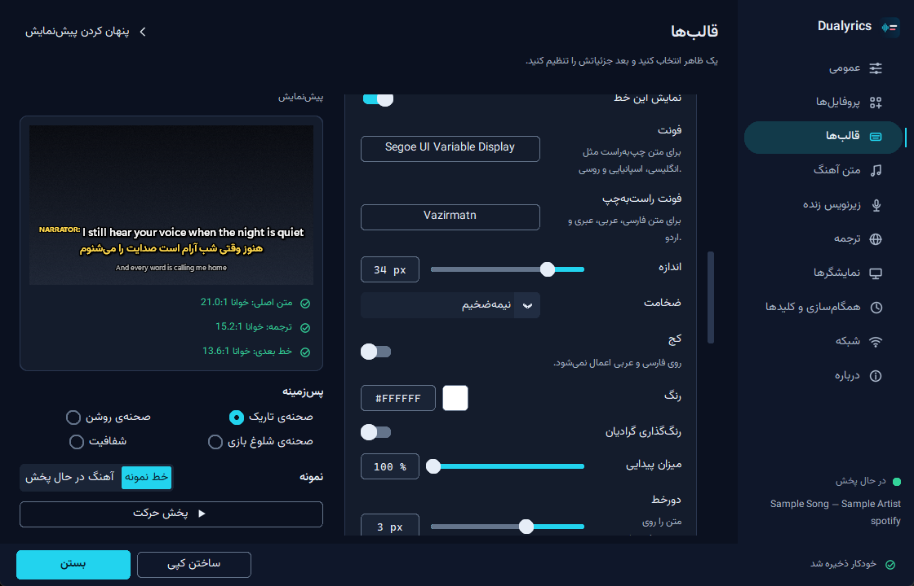
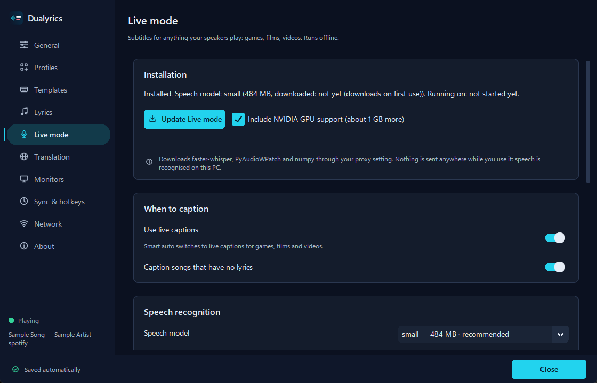
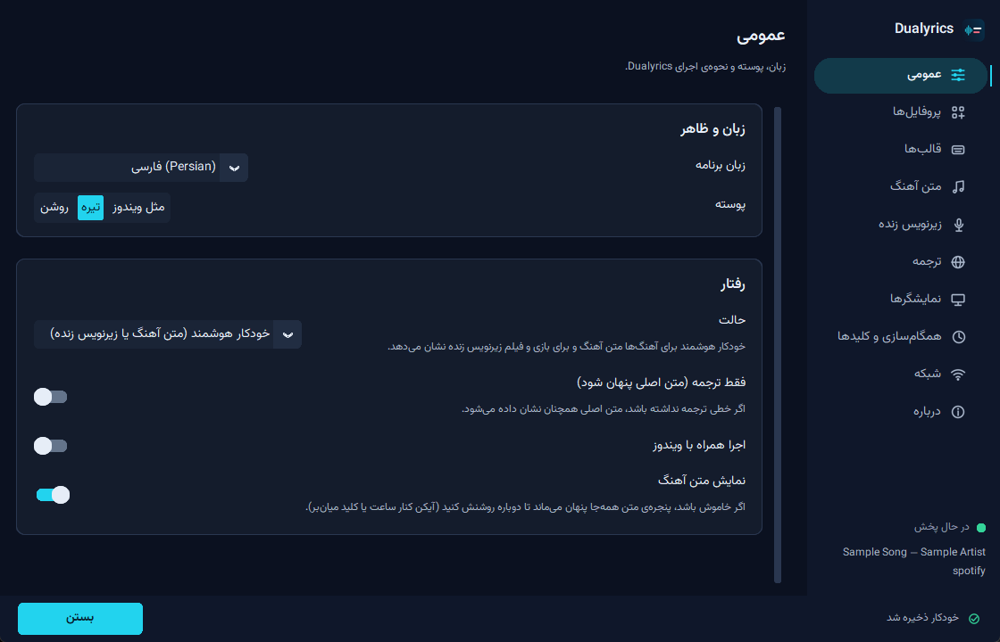

<div dir="rtl">

<p align="center"></p>

<h1 align="center">Dualyrics</h1>

<p align="center"><b>متن همگام آهنگ و زیرنویس زنده، با ترجمه زیر هر خط، در یک پنجره شناور روی ویندوز.</b><br>
برای Spotify، Spotube، یوتیوب موزیک، یوتیوب در مرورگر و هر پخش‌کننده‌ای که در کنترل‌های رسانه ویندوز دیده می‌شود؛ و با زیرنویس زنده برای بازی و فیلم.</p>

<p align="center">
<a href="../../releases/latest"></a>

<a href="LICENSE"></a>
</p>

<p align="center">

</p>

<p align="center"><a href="README.md">English</a></p>

## Dualyrics چیست؟

Dualyrics یک برنامه رایگان و متن‌باز برای ویندوز ۱۰ و ۱۱ است که متن آهنگی را که پخش می‌کنید، خط به خط و هم‌زمان با موسیقی نشان می‌دهد و زیر هر خط ترجمه‌اش را می‌نویسد. آهنگ در حال پخش را از کنترل‌های رسانه ویندوز می‌خواند، متن زمان‌بندی‌شده را از [LRCLIB](https://lrclib.net) می‌گیرد، کل آهنگ را یک‌جا با Google Gemini (با کلید رایگان خودتان) یا با Google Translate رایگان (بدون کلید) ترجمه می‌کند و یک نوار کوچک همیشه‌رو، بالای پنجره‌های دیگر نشان می‌دهد. با اسپاتیفای دسکتاپ، Spotube و یوتیوب یا یوتیوب موزیک در Chrome، Edge، Firefox، Brave و Opera کار می‌کند و به حساب اسپاتیفای یا هیچ ورودی نیاز ندارد.

نسخه ۲ یک **زیرنویس زنده**ی اختیاری اضافه می‌کند که هر صدایی را که از بلندگو پخش می‌شود به زیرنویس ترجمه‌شده تبدیل می‌کند؛ پس گفت‌وگوی بازی‌ها (مثلاً God of War Ragnarok)، فیلم‌ها و ویدیوها را به زبان خودتان دنبال می‌کنید. گفتار روی همین کامپیوتر تشخیص داده می‌شود. قالب‌های زیرنویس، تنظیمات جدا برای هر برنامه، حالت خودکار هوشمند (خودش بین متن آهنگ و زیرنویس زنده انتخاب می‌کند) و نصب‌کننده‌ی ویندوز هم در این نسخه آمده‌اند.

## امکانات

- متن همگام از LRCLIB: خطی که خوانده می‌شود، ترجمه‌اش، و خط بعدی به رنگ خاکستری. متن‌هایی که زمان‌بندی ندارند به شکل فهرست قابل اسکرول نمایش داده می‌شوند.
- ترجمه به ۴۶ زبان. Gemini کل آهنگ را یک‌جا می‌گیرد، پس اصطلاح‌ها، زبان عامیانه و بازی‌های کلامی با توجه به کل آهنگ ترجمه می‌شوند. حالت رایگان Google Translate کلید لازم ندارد.
- چینش راست‌به‌چپ برای فارسی، عربی، عبری، اردو، کردی سورانی و پشتو. فونت Vazirmatn همراه برنامه است (مجوز SIL Open Font License) و حروف فارسی را خود ویندوز می‌چسباند، پس همیشه درست به هم وصل می‌شوند.
- آهنگ‌هایی که از قبل به زبان مقصد هستند ترجمه نمی‌شوند تا سهمیه Gemini هدر نرود.
- چند کلید و چند مدل Gemini. وقتی سهمیه یکی تمام شود، سراغ بعدی می‌رود و در صورت نیاز از مترجم رایگان استفاده می‌کند.
- **قالب‌های زیرنویس (نسخه ۲)**: هشت ظاهر آماده (سینما، نتفلیکس، کارائوکه، مینیمال، نئون، حالت بازی، شیشه‌ای، کلاسیک فارسی) و ویرایشگری برای همه‌ی جزئیات، با پیش‌نمایش زنده. پنجره شفافیت واقعی دارد، پس سایه و درخشش روی هر بازی و فیلمی درست دیده می‌شود. با کشیدن لبه‌ها اندازه‌اش را عوض کنید؛ جا و اندازه برای هر نمایشگر و هر برنامه جدا ذخیره می‌شود.
- **چند نمایشگر و دسکتاپ مجازی**: نمایشگرهای مجاز را انتخاب کنید، پنجره می‌تواند دنبال نمایشگر برنامه‌ی فعال برود، و روی همه‌ی دسکتاپ‌های مجازی یا فقط دسکتاپ فعلی دیده شود.
- تنظیم هم‌زمانی: تأخیر کلی، تأخیر جداگانه برای هر آهنگ که ذخیره می‌شود، و کلیدهای میان‌بر سراسری قابل تغییر (`Ctrl+Alt+Up`، `Ctrl+Alt+Down`، `Ctrl+Alt+L`).
- آیکن در سینی ویندوز (کنار ساعت)، اجرای اختیاری همراه با ویندوز، و به خاطر سپردن جای پنجره برای هر مانیتور.
- پشتیبانی از پراکسی برای LRCLIB و ترجمه: بدون پراکسی، پراکسی سیستم، یا پراکسی دلخواه `http://` و `socks5://` با دکمه آزمایش اتصال.
- رابط کاربری انگلیسی و فارسی.
- **زیرنویس زنده (اختیاری، تازه در نسخه ۲)** برای بازی، فیلم و ویدیوهایی که متن ندارند: Dualyrics به صدایی که از بلندگو پخش می‌شود گوش می‌دهد، آن را سر مکث‌های طبیعی می‌بُرد، گفتار را بدون اینترنت با Whisper (کارت گرافیک NVIDIA یا CPU) تشخیص می‌دهد و ترجمه را لحظه‌ای بعد نشان می‌دهد. چون هر خط همراه خط‌های قبلی ترجمه می‌شود، اسم‌ها یکدست می‌مانند.
- **حالت خودکار هوشمند**: اگر آهنگ متن همگام داشته باشد متن آهنگ، اگر نداشته باشد زیرنویس زنده (اگر اجازه داده باشید)، و برای بازی‌ها و برنامه‌های تمام‌صفحه زیرنویس زنده. قاعده‌ها در [docs/ALGORITHM.md](docs/ALGORITHM.md) آمده است.
- **تنظیمات جدا برای هر برنامه**: هر برنامه (اسپاتیفای، مرورگر، VLC، یک بازی...) می‌تواند حالت، ظاهر، زبان، نمایشگر، جا و عبور کلیک خودش را داشته باشد. برنامه را از بین برنامه‌های باز، با انتخاب فایل exe یا با کلیک روی پنجره‌اش اضافه کنید.
- **فقط ترجمه**: متن اصلی پنهان می‌شود و فقط ترجمه دیده می‌شود.
- بدون حساب کاربری و بدون ارسال آمار. تنظیمات، کش و لاگ در `%APPDATA%\Dualyrics` می‌ماند و کلیدهای Gemini با DPAPI ویندوز برای کاربر شما رمزگذاری می‌شوند.

<p align="center">


</p>

## شروع سریع

### دانلود برنامه

1. فایل `Dualyrics-Setup-<version>.exe` را از [آخرین نسخه (Releases)](../../releases/latest) دانلود و اجرا کنید. نصب‌کننده فارسی و انگلیسی دارد، دسترسی مدیر (Admin) نمی‌خواهد و برنامه را فقط برای کاربر خودتان در `%LOCALAPPDATA%\Programs\Dualyrics` نصب می‌کند. میان‌بر منوی Start را می‌سازد و اگر بخواهید میان‌بر دسکتاپ و «اجرا همراه با ویندوز» را هم.
2. آخر نصب، Dualyrics باز می‌شود. بار اول پنجره تنظیمات باز می‌شود.
3. در **General › Translate into** (عمومی › ترجمه به زبان) زبان را انتخاب کنید و یک آهنگ پخش کنید.

نسخه‌ی قابل‌حمل می‌خواهید؟ `Dualyrics.exe` (یک فایل، بدون نصب) یا `Dualyrics-<version>-windows-x64.zip` (همان فایل همراه README و مجوز) را بگیرید. با `SHA256SUMS.txt` می‌توانید درستی هر فایل دانلودشده را بررسی کنید.

ممکن است SmartScreen ویندوز درباره برنامه امضانشده هشدار بدهد. اگر به فایل اعتماد دارید **More info › Run anyway** را بزنید، یا برنامه را از سورس اجرا کنید.

**ارتقا از نسخه ۱** (فایل قابل‌حمل): از نسخه ۱ خارج شوید و نصب‌کننده‌ی نسخه ۲ را اجرا کنید. تنظیمات، کلیدها و کش در `%APPDATA%\Dualyrics` می‌مانند و ظاهر نسخه ۱ به قالب **My style (v1)** تبدیل می‌شود. اگر نسخه ۱ همراه ویندوز اجرا می‌شد، نصب‌کننده همان را به نسخه‌ی نصب‌شده وصل می‌کند. بعد می‌توانید `Dualyrics.exe` قدیمی را پاک کنید.

**حذف برنامه**: از **Settings › Apps › Installed apps › Dualyrics** در ویندوز. حذف‌کننده برنامه را می‌بندد، آن را از اجرای خودکار برمی‌دارد و می‌پرسد تنظیمات، کش و مدل‌های گفتار دانلودشده هم پاک شوند یا نه (پیش‌فرض: نگه داشتن).

**نصب بی‌صدا** (برای اسکریپت): `Dualyrics-Setup-<version>.exe /VERYSILENT /SUPPRESSMSGBOXES /TASKS="desktopicon,startup"` (هر کدام را نمی‌خواهید حذف کنید). حذف بی‌صدا داده‌ها را نگه می‌دارد، مگر `/PURGE=1` بدهید.

### اجرا از سورس

نیازها: ویندوز ۱۰ یا ۱۱ و Python 3.10 یا جدیدتر.

<div dir="ltr">

```powershell
git clone <repository-url> Dualyrics
cd Dualyrics
python -m venv .venv
.venv\Scripts\pip install -r requirements.txt
.venv\Scripts\pythonw run.pyw
```

</div>

گزینه‌های خط فرمان: `--settings` پنجره تنظیمات را باز می‌کند، `--debug` لاگ کامل می‌نویسد، `--quit` نسخه‌ی در حال اجرا را می‌بندد (نصب‌کننده پیش از ارتقا از آن استفاده می‌کند) و `--version` نسخه را نشان می‌دهد. اگر برنامه را دوباره اجرا کنید، پنجره تنظیمات همان نسخه در حال اجرا باز می‌شود.

### ساختن فایل exe و نصب‌کننده

<div dir="ltr">

```powershell
.venv\Scripts\pip install -r requirements-build.txt
powershell -ExecutionPolicy Bypass -File tools\build.ps1
```

</div>

`tools\build.ps1` اول تست‌ها را اجرا می‌کند، بعد PyInstaller را با `Dualyrics.spec` و بعد [Inno Setup](https://jrsoftware.org/isinfo.php) نسخه ۶.۳ یا جدیدتر را با `installer\Dualyrics.iss` (نصب با `winget install JRSoftware.InnoSetup` یا `choco install innosetup`؛ یا با `-NoInstaller` بدون نصب‌کننده بسازید). خروجی آن `dist\Dualyrics.exe`، `dist\Dualyrics-<version>-windows-x64.zip`، `dist\Dualyrics-Setup-<version>.exe` و `dist\SHA256SUMS.txt` است. پیام‌های فارسی نصب‌کننده ترجمه‌ی غیررسمی Inno Setup است که هنگام ساخت از یک نسخه‌ی ثابت دانلود و با SHA-256 بررسی می‌شود. فایل exe بسته‌های گفتار زیرنویس زنده (حدود ۲۵۰ مگابایت) را ندارد تا کوچک بماند و زود باز شود. با push کردن تگ `v*` همین ساخت روی GitHub Actions انجام می‌شود و این فایل‌ها به یک GitHub Release اضافه می‌شوند. تغییرات هر نسخه در [CHANGELOG.md](CHANGELOG.md) آمده است.

### گرفتن کلید رایگان Gemini (اختیاری، ترجمه بهتر)

1. وارد [Google AI Studio](https://aistudio.google.com/) شوید و **Get API key** را بزنید.
2. در **تنظیمات › ترجمه**، گزینه **Gemini** را انتخاب کنید، کلید را بچسبانید و **آزمایش** را بزنید.

بدون کلید، Dualyrics از Google Translate رایگان استفاده می‌کند.

## کار با پنجره

| کار | نتیجه |
|---|---|
| کشیدن با ماوس | جابه‌جا کردن پنجره‌ی متن (اگر قفل نباشد) |
| کشیدن لبه‌ی چپ یا راست | باریک یا پهن کردن کادر؛ متن دوباره چیده می‌شود |
| کشیدن لبه‌ی بالا یا پایین یا گوشه‌ها | بزرگ یا کوچک کردن متن |
| چرخ ماوس | بزرگ و کوچک کردن متن. روی متن بدون زمان‌بندی اسکرول می‌کند و `Ctrl` + چرخ اندازه را عوض می‌کند |
| دوبار کلیک | نمایش یا پنهان کردن خط بعدی |
| کلیک راست | منو: حالت، نمایش (هر دو، فقط ترجمه، فقط اصلی، خط بعدی)، قالب، اندازه‌ی متن، میزان پیدایی، جا و نمایشگر، زبان ترجمه، تنظیم زمان (این آهنگ یا همه)، کپی خط یا کل متن با ترجمه، ویرایش ترجمه‌ی همین خط، ترجمه‌ی دوباره، قفل، عبور کلیک (`Ctrl+Alt+K`)، پنهان برای این آهنگ یا برنامه، توقف زیرنویس زنده، ذخیره‌ی متن گفت‌وگو، تنظیمات، خروج |
| آیکن سینی ویندوز | نمایش متن، تنظیمات، ترجمه دوباره، عبور کلیک، قفل جای پنجره، باز کردن پوشه کش، خروج. کلیک چپ تنظیمات را باز می‌کند |

وقتی «عبور کلیک» روشن است، نوار به ماوس واکنش نشان نمی‌دهد. برای خاموش کردنش از آیکن سینی ویندوز استفاده کنید.

<p align="center">


</p>

## زیرنویس زنده (اختیاری)

زیرنویس زنده هر صدایی را که از بلندگو پخش می‌شود به زیرنویس تبدیل می‌کند: گفت‌وگوی بازی‌ها (مثل God of War)، فیلم، ویدیوی یوتیوب و آهنگ‌هایی که LRCLIB متنشان را ندارد. گفتار روی همین کامپیوتر با faster-whisper تشخیص داده می‌شود و فقط متن تشخیص‌داده‌شده برای ترجمه فرستاده می‌شود، مثل متن آهنگ.

1. **تنظیمات › زیرنویس زنده › نصب زیرنویس زنده** را بزنید. numpy و faster-whisper و PyAudioWPatch (حدود ۱۵۰ مگابایت، با تنظیم پراکسی شما) دانلود می‌شوند. برای کارت گرافیک NVIDIA تیک مربوط را هم بزنید (حدود ۱ گیگابایت بیشتر). نسخه‌ی نصب‌شده این بسته‌ها را در `%APPDATA%\Dualyrics\live-runtime` می‌گذارد و فقط برای همین دانلود یک بار به [Python 3.12](https://www.python.org/downloads/) روی کامپیوتر نیاز دارد (خود برنامه از آن استفاده نمی‌کند).
2. مدل گفتار را انتخاب کنید: `small` پیشنهادی است، `tiny` و `base` سبک‌ترند و `medium` کارت گرافیک می‌خواهد. برای بازی و فیلم انگلیسی «مدل فقط انگلیسی» را روشن کنید. مدل فقط بار اول در `%APPDATA%\Dualyrics\models` دانلود می‌شود.
3. تمام. در حالت «خودکار هوشمند» زیرنویس زنده برای بازی‌های تمام‌صفحه، برنامه‌هایی که در **تنظیمات › پروفایل‌ها** به‌عنوان «بازی» اضافه شده‌اند، و آهنگ یا ویدیوی بدون متن خودش روشن می‌شود.

توقف و ادامه از منوی آیکن کنار ساعت یا با `Ctrl+Alt+P`. بازی باید در حالت Borderless یا Windowed اجرا شود؛ روی تمام‌صفحه‌ی انحصاری هیچ پنجره‌ای دیده نمی‌شود. با «ذخیره‌ی متن گفت‌وگوها» هر خط و ترجمه‌اش در `%APPDATA%\Dualyrics\transcripts` ذخیره می‌شود.

<p align="center">

</p>

## تنظیمات جدا برای هر برنامه (پروفایل‌ها)

هر برنامه می‌تواند حالت (خودکار هوشمند، متن آهنگ، زیرنویس زنده یا خاموش)، قالب، زبان ترجمه، نمایشگر، جا، عرض، عبور کلیک و «فقط ترجمه»ی خودش را داشته باشد. **تنظیمات › پروفایل‌ها** از اول برای اسپاتیفای، Spotube، برنامه‌های موسیقی، مرورگرها، VLC، MPC-HC/BE و PotPlayer پروفایل دارد، و یک پروفایل **بازی‌ها** برای برنامه‌های تمام‌صفحه (زیرنویس زنده، قالب حالت بازی، عبور کلیک). فهرست از بالا به پایین بررسی می‌شود و اولین برنامه‌ای که بخورد برنده است. برنامه را از بین برنامه‌های باز (با آیکنشان)، با انتخاب فایل `.exe` یا با کلیک روی پنجره‌اش اضافه کنید؛ با خروجی و ورودی گرفتن، فهرست را به کامپیوتر دیگر ببرید.

<p align="center">

</p>

## تنظیمات

هر تغییری فوراً اعمال و خودکار ذخیره می‌شود. پنجره‌ی تنظیمات ده بخش در نوار کناری دارد: عمومی، پروفایل‌ها، قالب‌ها، متن آهنگ، زیرنویس زنده، ترجمه، نمایشگرها، همگام‌سازی و کلیدها، شبکه و درباره. در زبان فارسی کل پنجره راست‌به‌چپ و قرینه می‌شود. تنظیمات در `%APPDATA%\Dualyrics\settings.json` ذخیره می‌شود. با متغیر محیطی `DUALYRICS_HOME` می‌توانید همه داده‌ها را در پوشه دیگری نگه دارید (نسخه قابل حمل).

| زبانه | گزینه‌ها |
|---|---|
| عمومی | زبان برنامه (انگلیسی/فارسی)، پوسته (تیره، روشن، مثل ویندوز)، حالت (خودکار هوشمند، فقط متن آهنگ، فقط زیرنویس زنده)، فقط ترجمه، اجرا همراه با ویندوز، نمایش پنجره‌ی متن |
| پروفایل‌ها | تنظیمات جدا برای هر برنامه (حالت، قالب، زبان، نمایشگر، جا، عرض، عبور کلیک، فقط ترجمه)، افزودن برنامه از برنامه‌های باز، با فایل exe یا با کلیک روی پنجره |
| زیرنویس زنده | نصب، مدل گفتار، مدل فقط انگلیسی، زبان گفتار، اجرا روی CPU یا کارت گرافیک، حساسیت به صدا، طول تکه‌ها، سرعت خواندن، کمترین زمان نمایش، خط‌های قبلی برای فهم متن، ذخیره‌ی متن‌ها، توقف و ادامه |
| ترجمه | زبان ترجمه (۴۶ زبان)، سرویس ترجمه (Gemini یا رایگان)، کلیدها و مدل‌های Gemini با دکمه آزمایش، استفاده از مترجم رایگان وقتی Gemini کار نکرد، دستور سبک ترجمه، ترجمه نکردن آهنگ‌هایی که به زبان مقصدند، پاک کردن کش |
| قالب‌ها | هشت ظاهر آماده (سینما، نتفلیکس، کارائوکه، مینیمال، نئون، حالت بازی، شیشه‌ای، کلاسیک فارسی) و ویرایشگر همه‌ی جزئیات: فونت جدا برای فارسی، اندازه، ضخامت، رنگ یا گرادیان، دورخط، تا چهار سایه یا درخشش، کادر، لبه، گوشه‌ی گرد، برجسته‌سازی کارائوکه، حرکت محو و لغزش، کمترین زمان نمایش؛ پیش‌نمایش زنده روی صحنه‌ی تاریک، روشن و شلوغ بازی با سنجش خوانایی؛ کپی، تغییر نام، حذف (با برگرداندن)، وارد کردن و خروجی گرفتن به‌صورت `.json` |
| متن آهنگ | پنهان شدن وقتی چیزی پخش نمی‌شود، نمایش هر خط، ارتفاع متن بدون زمان‌بندی، پخش‌کننده‌های ترجیحی |
| نمایشگرها | روشن یا خاموش بودن هر نمایشگر، نمایشگر نمایش، دنبال کردن نمایشگر برنامه‌ی فعال، جای پنجره، اندازه‌ی متن، میزان پیدایی، قفل، عبور کلیک، همه‌ی دسکتاپ‌های مجازی یا فقط دسکتاپ فعلی |
| همگام‌سازی | تأخیر کلی، تأخیر همین آهنگ، گام تأخیر، کلیدهای میان‌بر سراسری (از جمله توقف زیرنویس زنده) |
| شبکه | بدون پراکسی، پراکسی سیستم یا پراکسی دلخواه، آزمایش اتصال |
| درباره | نسخه برنامه، باز کردن پوشه داده‌ها و لاگ |

فهرست کامل کلیدهای `settings.json` با مقدار پیش‌فرض در [README انگلیسی](README.md#configuration) آمده است.

## پخش‌کننده‌های پشتیبانی‌شده

هر برنامه‌ای که آهنگش در پنجره کنترل رسانه ویندوز (کنار پنجره صدا) دیده شود، کار می‌کند. این‌ها در فهرست پیش‌فرض هستند: اسپاتیفای دسکتاپ (`spotify`)، Spotube (`spotube`)، برنامه Media Player ویندوز (`zunemusic`)، یوتیوب و یوتیوب موزیک در Chrome (`chrome`)، Edge (`msedge`)، Firefox (`firefox`)، Brave و Opera، و VLC در نسخه‌هایی که به کنترل رسانه ویندوز گزارش می‌دهند (`vlc`).

## پرسش‌های رایج

### چطور ترجمه متن آهنگ را روی اسپاتیفای دسکتاپ ببینم؟

Dualyrics را نصب کنید، در **تنظیمات › عمومی › ترجمه به زبان** زبان را انتخاب کنید و در برنامه اسپاتیفای آهنگ پخش کنید. اسپاتیفای آهنگ را به کنترل‌های رسانه ویندوز گزارش می‌دهد و Dualyrics متن همگام را با ترجمه زیر هر خط، در پنجره خودش بالای اسپاتیفای نشان می‌دهد. لازم نیست وارد هیچ حسابی شوید.

### آیا می‌شود متن آهنگ‌های اسپاتیفای را به فارسی ترجمه کرد؟

بله. Dualyrics به ۴۶ زبان ترجمه می‌کند، از جمله فارسی، عربی، ترکی، اسپانیایی، آلمانی، فرانسوی و روسی. فارسی به شکل راست‌به‌چپ و با فونت مناسب نمایش داده می‌شود. برای ترجمه طبیعی‌تر یک کلید رایگان Gemini اضافه کنید؛ بدون کلید از Google Translate رایگان استفاده می‌شود.

### چطور برای یوتیوب موزیک در ویندوز متن همگام با ترجمه بگیرم؟

یوتیوب موزیک یا یک موزیک‌ویدیو در یوتیوب را در Chrome، Edge، Firefox، Brave یا Opera پخش کنید و Dualyrics را باز نگه دارید. مرورگر عنوان را به ویندوز می‌دهد، Dualyrics عنوان‌هایی مثل «Artist - Song (Official Video)» را تمیز می‌کند، متن همگام را از LRCLIB پیدا می‌کند و ترجمه را زیر هر خط نشان می‌دهد.

### برنامه رایگان است؟ کلید API لازم دارد؟

رایگان است و مجوز MIT دارد. کلید لازم نیست، چون مترجم پیش‌فرض Google Translate رایگان است. کلید Gemini اختیاری است و ترجمه اصطلاح‌ها و زبان عامیانه را بهتر می‌کند. سهمیه رایگان Gemini را گوگل تعیین می‌کند.

### روی مک یا لینوکس کار می‌کند؟

نه. Dualyrics از کنترل‌های رسانه، رجیستری و توابع پنجره ویندوز استفاده می‌کند و فقط روی ویندوز ۱۰ و ۱۱ اجرا می‌شود.

### متن زودتر یا دیرتر از آهنگ می‌آید. چطور درستش کنم؟

`Ctrl+Alt+Up` متن را دیرتر و `Ctrl+Alt+Down` زودتر می‌کند، به طور پیش‌فرض ۲۵۰ میلی‌ثانیه با هر بار زدن. این تأخیر برای همان آهنگ ذخیره می‌شود. تأخیر کلی برای همه آهنگ‌ها در **تنظیمات › همگام‌سازی** است.

### آیا Dualyrics گفت‌وگوی بازی‌ها را ترجمه می‌کند؟ مثلاً God of War Ragnarok؟

بله، با زیرنویس زنده. Dualyrics زیرنویس خود بازی را نمی‌خواند؛ به صدای بازی گوش می‌دهد، گفتار را روی کامپیوتر خودتان با Whisper تشخیص می‌دهد و ترجمه را یکی دو ثانیه بعد از گفته شدن جمله، روی بازی نشان می‌دهد. بازی را در حالت Borderless یا Windowed اجرا کنید و یک بار «نصب زیرنویس زنده» را بزنید؛ در حالت «خودکار هوشمند» وقتی بازی تمام‌صفحه شود زیرنویس خودش روشن می‌شود (پروفایل «بازی‌ها» عبور کلیک را هم روشن می‌کند). برای بازی‌های انگلیسی «مدل فقط انگلیسی» را روشن کنید. موسیقی یا صدای بلند نبرد روی صداها دقت را کم می‌کند و ممکن است یک جمله‌ی کوتاه جا بیفتد.

### می‌توانم فیلم یا ویدیوی یوتیوب را با زیرنویس ترجمه‌شده ببینم؟

بله. وقتی ویدیو متن آهنگ ندارد، زیرنویس زنده چیزی را که می‌شنوید زیرنویس می‌کند؛ در مرورگر، VLC، MPC-HC، PotPlayer یا هر پخش‌کننده‌ی دیگر. هر خط همراه چند خط قبلی ترجمه می‌شود، پس اسم‌ها و اصطلاح‌ها در طول فیلم یکدست می‌مانند.

### زیرنویس زنده صدای من را به اینترنت می‌فرستد؟ بازی را کند می‌کند؟

هیچ صدایی از کامپیوتر بیرون نمی‌رود: تشخیص گفتار بدون اینترنت انجام می‌شود و فقط متن تشخیص‌داده‌شده برای ترجمه فرستاده می‌شود، مثل متن آهنگ. روی کارت گرافیک NVIDIA، Whisper از کارت گرافیک و بخشی از حافظه‌ی آن استفاده می‌کند؛ بدون آن روی CPU اجرا می‌شود و هنگام بازی مدل `tiny` یا `base` انتخاب بهتری است. هر وقت خواستید با `Ctrl+Alt+P` متوقفش کنید.

### برای استفاده از Dualyrics به Python نیاز دارم؟

نه. نصب‌کننده و فایل قابل‌حمل همه‌چیز را برای متن آهنگ و ترجمه دارند. فقط دانلود یک‌باره‌ی «نصب زیرنویس زنده» در نسخه‌ی نصب‌شده از Python 3.12 استفاده می‌کند، چون بسته‌های گفتار را با pip نصب می‌کند.

## حریم خصوصی

Dualyrics حساب کاربری، ارسال آمار و بررسی خودکار به‌روزرسانی ندارد. فقط این درخواست‌ها را، از طریق پراکسی‌ای که انتخاب کرده‌اید، می‌فرستد:

| مقصد | چه چیزی فرستاده می‌شود | چه وقت |
|---|---|---|
| LRCLIB (`lrclib.net`) | نام آهنگ، خواننده، آلبوم و مدت آهنگ | برای پیدا کردن متن آهنگ جدید و برای آزمایش اتصال |
| Google Gemini (`generativelanguage.googleapis.com`) | خط‌های متن، نام آهنگ و خواننده، زبان مقصد، متن سبک ترجمه و کلید API شما | فقط وقتی سرویس Gemini انتخاب شده و آهنگ در کش نیست |
| Google Translate (`translate.googleapis.com`) | خط‌های متن و زبان مقصد | در حالت رایگان، یا وقتی Gemini کار نکند |
| Gemini یا Google Translate | در زیرنویس زنده: هر خط تشخیص‌داده‌شده، چند خط قبلی با ترجمه‌شان و نام برنامه یا بازی | وقتی زیرنویس زنده و ترجمه روشن است |
| Hugging Face (`huggingface.co`) | درخواست دانلود مدل Whisper انتخاب‌شده | برای هر مدل یک بار، اولین استفاده از زیرنویس زنده |
| PyPI (`pypi.org`) | درخواست دانلود بسته‌های زیرنویس زنده | فقط وقتی «نصب زیرنویس زنده» را بزنید |

بقیه چیزها روی کامپیوتر خودتان در `%APPDATA%\Dualyrics` می‌ماند: `settings.json` (کلیدهای Gemini رمزگذاری‌شده با DPAPI)، پوشه `cache` (متن‌ها، ترجمه‌ها، تأخیر هر آهنگ)، `models` (مدل‌های Whisper)، `live-runtime` (بسته‌های زیرنویس زنده، فقط نسخه‌ی نصب‌شده) و `logs\dualyrics.log` (ممکن است نام آهنگ‌ها در آن باشد). برای پاک کردن کامل، برنامه را حذف کنید و وقتی درباره‌ی تنظیمات پرسید **بله** را بزنید؛ در نسخه‌ی قابل‌حمل، «اجرا همراه با ویندوز» را خاموش کنید، از برنامه خارج شوید و این پوشه را حذف کنید.

حالت رایگان از یک آدرس غیررسمی Google Translate استفاده می‌کند که ممکن است محدود شود یا بدون اطلاع تغییر کند.

## رفع مشکل

| مشکل | راه‌حل |
|---|---|
| خطای شبکه یا پیدا نشدن هیچ متنی | در **تنظیمات › شبکه** دکمه **آزمایش اتصال** را بزنید. اگر LRCLIB یا گوگل در دسترس نیست، پراکسی تنظیم کنید |
| از یک برنامه پراکسی محلی استفاده می‌کنید (مثلاً کلاینت SOCKS5 روی `127.0.0.1`) | گزینه **دلخواه** را انتخاب کنید و `socks5://127.0.0.1:<port>` یا `http://127.0.0.1:<port>` را وارد کنید. اگر DNS هم باید از پراکسی رد شود `socks5h://` بنویسید. گزینه **پراکسی سیستم** از تنظیمات پراکسی ویندوز و متغیرهای `HTTP_PROXY`/`HTTPS_PROXY` استفاده می‌کند |
| «ترجمه انجام نشد (سهمیه، کلید یا اینترنت)» | در زبانه ترجمه **آزمایش** را بزنید. کلید یا مدل دیگری اضافه کنید یا مترجم رایگان را روشن کنید، بعد روی نوار کلیک راست کنید و **ترجمه‌ی دوباره‌ی این آهنگ** را بزنید |
| نوار آهنگ پخش‌کننده دیگری را نشان می‌دهد | پخش‌کننده خودتان را اول فهرست **پخش‌کننده‌های ترجیحی** بگذارید |
| هیچ چیزی نمایش داده نمی‌شود | ببینید آهنگ در پنجره کنترل رسانه ویندوز دیده می‌شود یا نه. اگر نه، آن پخش‌کننده به ویندوز گزارش نمی‌دهد |
| نوار به ماوس واکنش نمی‌دهد | «عبور کلیک» روشن است. از آیکن سینی ویندوز خاموشش کنید |
| کلید میان‌بر کار نمی‌کند | احتمالاً برنامه دیگری از آن استفاده می‌کند. در زبانه همگام‌سازی ترکیب دیگری بگذارید و **اعمال** را بزنید |
| زیرنویس زنده روی بازی دیده نمی‌شود | بازی را در حالت Borderless یا Windowed بگذارید. ببینید در **تنظیمات › زیرنویس زنده** نوشته «نصب شده» و صدای بازی از خروجی صدای پیش‌فرض پخش می‌شود |
| هنگام نصب زیرنویس زنده: «Python 3.12 not found» | Python 3.12 را از python.org نصب کنید (گزینه‌ی Add to PATH یا py launcher)، بعد دوباره «نصب زیرنویس زنده» را بزنید |
| مشکل دیگر | برنامه را با `--debug` اجرا کنید و لاگ را از **درباره › باز کردن لاگ** بخوانید |

## مشارکت

گزارش باگ، ترجمه رابط کاربری و Pull Request خوش‌آمد است. راهنما در [CONTRIBUTING.md](CONTRIBUTING.md) است.

## سپاس

- متن آهنگ‌ها از [LRCLIB](https://lrclib.net)، یک پایگاه داده آزاد و رایگان متن آهنگ. اگر می‌توانید از آن حمایت کنید و متن‌های جاافتاده را اضافه کنید.
- رابط کاربری با [CustomTkinter](https://github.com/TomSchimansky/CustomTkinter)، [pystray](https://github.com/moses-palmer/pystray) و Pillow ساخته شده است.
- زیرنویس زنده از [faster-whisper](https://github.com/SYSTRAN/faster-whisper) و مدل‌های Whisper تبدیل‌شده‌ی SYSTRAN، و برای ضبط صدای خروجی از [PyAudioWPatch](https://github.com/s0d3s/PyAudioWPatch) استفاده می‌کند. فونت [Vazirmatn](https://github.com/rastikerdar/vazirmatn) با مجوز SIL Open Font License همراه برنامه است.
- نصب‌کننده با [Inno Setup](https://jrsoftware.org/isinfo.php) ساخته شده و پیام‌های فارسی‌اش ترجمه‌ی غیررسمی Inno Setup است.

حق متن آهنگ‌ها متعلق به صاحبانشان است. Dualyrics فقط متنی را که از LRCLIB می‌گیرد روی کامپیوتر خودتان نمایش می‌دهد.

## مجوز

[MIT](LICENSE). Copyright (c) 2026 Dualyrics contributors.

</div>
