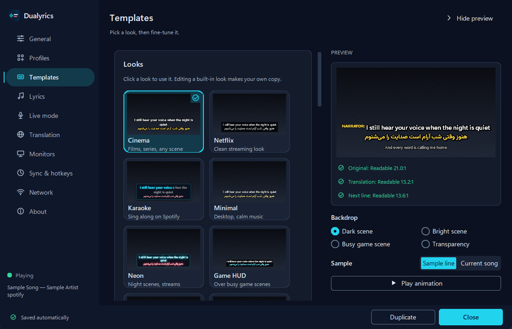
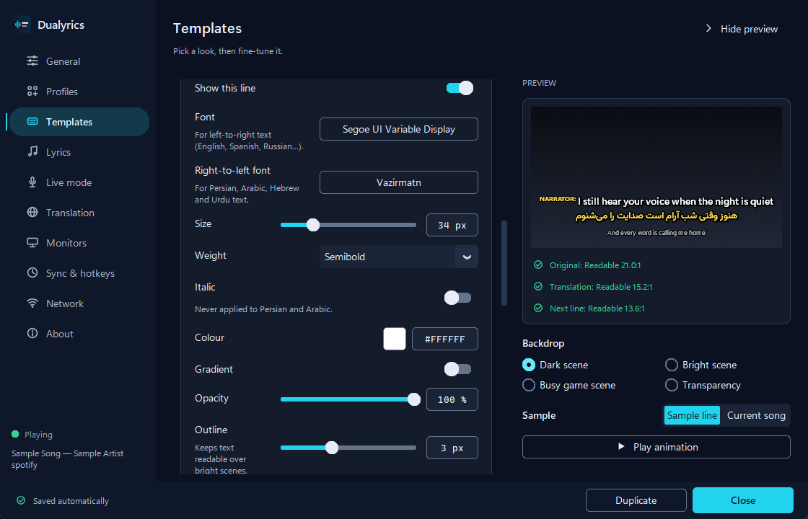

<p align="center"></p>

<h1 align="center">Dualyrics</h1>

<p align="center"><b>Synced lyrics and live captions with a translation under every line, in a floating overlay on Windows.</b><br>
For Spotify, Spotube, YouTube Music, YouTube in the browser and any player that shows up in Windows media controls, and with Live mode for games and films too.</p>

<p align="center">
<a href="../../releases/latest"></a>


<a href="LICENSE"></a>
<a href="https://lrclib.net"></a>
</p>

<p align="center">

</p>

<p align="center"><a href="README.fa.md">فارسی</a></p>

## What is Dualyrics?

Dualyrics is a free, open-source Windows 10/11 app that shows the lyrics of the song you are playing, line by line and in time with the music, with a translation under each line. It reads the current track from Windows media controls, downloads time-synced lyrics from [LRCLIB](https://lrclib.net), translates the whole song in one request with Google Gemini (your own free API key) or with free Google Translate (no key), and draws a small always-on-top bar over your other windows. It works with Spotify desktop, Spotube, and YouTube or YouTube Music in Chrome, Edge, Firefox, Brave or Opera. It does not need a Spotify account or any login.

Version 2 adds an optional **Live mode** that turns whatever your speakers play into translated subtitles, so you can follow game dialogue (for example God of War Ragnarok), films and videos in your own language. Speech is recognised on your PC. It also adds subtitle templates, per-app profiles, a smart auto mode that picks lyrics or live captions by itself, and a Windows installer.

Contents: [Features](#features) · [Quick start](#quick-start) · [Using the overlay](#using-the-overlay) · [Live mode](#live-mode-optional) · [Per-app profiles](#per-app-profiles) · [Configuration](#configuration) · [How it works](#how-it-works) · [Supported players](#supported-players) · [FAQ](#faq) · [Privacy](#privacy) · [Troubleshooting](#troubleshooting) · [Contributing](#contributing)

## Features

- Time-synced lyrics from LRCLIB: the current line, its translation, and the next line in grey. Lyrics without timing are shown as a list you can scroll.
- Translation into 46 languages. Gemini gets the whole song at once, so idioms, slang and wordplay are translated in context. Free Google Translate mode needs no key.
- Right-to-left layout for Persian, Arabic, Hebrew, Urdu, Kurdish (Sorani) and Pashto. The Vazirmatn font is bundled (SIL Open Font License) and Persian letters are shaped by Windows, so they always join correctly.
- Songs already in your target language are not translated, which saves Gemini quota.
- Several Gemini keys and models. When one hits its quota, Dualyrics moves to the next, and it can fall back to the free translator.
- **Subtitle templates (v2)**: eight built-in looks (Cinema, Netflix, Karaoke, Minimal, Neon, Game HUD, Glass, Persian Classic) and a template editor for every detail: fonts per script, size, weight, colour or gradient, outline, up to four soft shadows or glows, letter spacing, line height, box colour, gradient, rim, corner radius and drop shadow, karaoke highlight (whole line, sweep), fade and slide motion, minimum time on screen. Live preview over dark, bright and busy game scenes with a contrast check. Duplicate, rename, delete (with undo), import and export as `.json`.
- **A real subtitle overlay**: per-pixel transparency, so soft shadows and glow look right over any game or film. Drag it to move it, drag an edge or corner to resize it (the text reflows or scales), or use the mouse wheel. Position and size are remembered per monitor and per app.
- **Multi-monitor and virtual desktops**: choose the monitors the overlay may use, follow the monitor of the app you are using, move it to another monitor from the menu; it comes back on screen when a monitor is unplugged. Show it on all virtual desktops or only on the current one.
- **A rich right-click menu**: mode, which lines to show, template, text size, opacity, position and monitor, target language, sync offset (this song or all songs), copy the line or the whole song with its translation, edit one line's translation (kept in the cache), retranslate, lock, click-through, hide for this song or app, pause live captions, save the transcript.
- Sync controls: a global offset, a per-song offset that is remembered, and global hotkeys (`Ctrl+Alt+Up`, `Ctrl+Alt+Down`, `Ctrl+Alt+L`) that you can change.
- System tray icon and optional start with Windows.
- Proxy support for LRCLIB and translation requests: no proxy, the system proxy, or a custom `http://` or `socks5://` proxy, with a connection test.
- English and Persian interface.
- **Live captions (optional, new in v2)** for games, films and videos with no lyrics: Dualyrics listens to what your speakers play, cuts the audio at natural pauses, recognises speech offline with Whisper (NVIDIA GPU or CPU) and shows the translation a moment later. Names stay consistent because each line is translated with the lines before it. See [Live mode](#live-mode-optional).
- **Smart auto mode**: synced lyrics when the song has them, live captions when it does not (if you allow it), and live captions for games and fullscreen apps. The rules are in [docs/ALGORITHM.md](docs/ALGORITHM.md).
- **Per-app settings**: each app (Spotify, a browser, VLC, a game...) can have its own mode, look, language, monitor, position and click-through. Add apps from the running ones, by picking an .exe, or by clicking their window.
- **Translation only**: hide the original line and show just the translation.
- No account and no telemetry. Settings, cache and logs stay in `%APPDATA%\Dualyrics`, and Gemini keys are encrypted with Windows DPAPI for your Windows user.

<p align="center">


</p>

## Quick start

### Download the app

1. Download `Dualyrics-Setup-<version>.exe` from the [latest release](../../releases/latest) and run it. Setup speaks English or Persian, needs no admin rights and installs for your Windows user only, into `%LOCALAPPDATA%\Programs\Dualyrics`. It adds a Start menu shortcut, and optionally a desktop shortcut and **Start with Windows**.
2. Dualyrics starts at the end of Setup. The settings window opens on the first start.
3. Pick your language under **General › Translate into** and play a song.

Prefer a portable copy? Download `Dualyrics.exe` (one file, no installation) or `Dualyrics-<version>-windows-x64.zip` (the same exe with the README and license). `SHA256SUMS.txt` lets you check every download.

Windows SmartScreen may warn about an unsigned app from a new publisher. Choose **More info › Run anyway** if you trust the download, or build it yourself from source.

**Upgrading from v1** (the portable exe): quit v1 and run the v2 installer. Your settings, keys and cache in `%APPDATA%\Dualyrics` are kept, and your v1 look becomes the template **My style (v1)**. If v1 started with Windows, Setup points that entry at the installed copy. You can then delete the old `Dualyrics.exe`.

**Uninstalling**: use **Windows Settings › Apps › Installed apps › Dualyrics**. The uninstaller closes Dualyrics, removes it from startup and asks whether to also delete your settings, cache and downloaded speech models (the default keeps them).

**Silent install** (for scripts): `Dualyrics-Setup-<version>.exe /VERYSILENT /SUPPRESSMSGBOXES /TASKS="desktopicon,startup"` (leave out the tasks you do not want). A silent uninstall keeps your data unless you add `/PURGE=1`.

### Run from source

Requirements: Windows 10 or 11 and Python 3.10 or newer.

```powershell
git clone <repository-url> Dualyrics
cd Dualyrics
python -m venv .venv
.venv\Scripts\pip install -r requirements.txt
.venv\Scripts\pythonw run.pyw
```

You can also install it as a package and start it with the `dualyrics` command:

```powershell
pip install .
dualyrics
```

Command-line options: `--settings` opens the settings window on start, `--debug` writes a verbose log, `--quit` closes the running copy (Setup uses it before an upgrade), `--version` prints the version. Starting Dualyrics a second time opens the settings window of the copy that is already running.

### Build the .exe and the installer yourself

```powershell
.venv\Scripts\pip install -r requirements-build.txt
powershell -ExecutionPolicy Bypass -File tools\build.ps1
```

`tools\build.ps1` runs the tests, then PyInstaller with `Dualyrics.spec`, then [Inno Setup](https://jrsoftware.org/isinfo.php) 6.3 or later with `installer\Dualyrics.iss` (install it with `winget install JRSoftware.InnoSetup` or `choco install innosetup`, or build with `-NoInstaller`). It writes `dist\Dualyrics.exe`, `dist\Dualyrics-<version>-windows-x64.zip`, `dist\Dualyrics-Setup-<version>.exe` and `dist\SHA256SUMS.txt`. The Persian Setup messages are the unofficial Inno Setup translation, downloaded at build time from a pinned version and checked by SHA-256. Pushing a `v*` tag runs the same build on GitHub Actions and attaches these files to a GitHub Release. Changes are listed in [CHANGELOG.md](CHANGELOG.md).

The exe does not contain Live mode's speech packages (about 250 MB), so it stays small and starts fast; see [Live mode](#live-mode-optional).

### Get a free Gemini key (optional, better translations)

1. Open [Google AI Studio](https://aistudio.google.com/) and choose **Get API key**.
2. In **Settings › Translation**, choose **Gemini**, paste the key and press **Test**.

Without a key, Dualyrics uses free Google Translate.

## Using the overlay

| Action | Result |
|---|---|
| Drag | Moves the overlay (unless the position is locked) |
| Drag a left or right edge | Makes the box narrower or wider; the text reflows |
| Drag the top or bottom edge, or a corner | Scales the text |
| Mouse wheel | Makes the text bigger or smaller. On unsynced lyrics it scrolls, and `Ctrl` + wheel resizes |
| Double-click | Shows or hides the next line |
| Right-click | The menu below |
| Tray icon | Show lyrics, settings, retranslate, translation only, pause live captions, click-through, lock position, open cache folder, quit. Left-click opens settings |

Position and size are saved for each monitor, and for each app profile when one is active (so Spotify and a game can each keep their own place).

<p align="center">

</p>

With click-through on, the overlay ignores the mouse. Turn it off again with `Ctrl+Alt+K` or from the tray icon.

<p align="center">




</p>

### Templates

A template is one JSON file that describes the whole look: fonts, colours, outline, shadows and glow, the box, line order, karaoke highlight and motion. Pick one in **Settings › Templates** or from the overlay menu. Editing a built-in look creates your own copy (`based_on` remembers the preset, so **Reset to preset** always works). Your templates live in `%APPDATA%\Dualyrics\templates`; **Export** and **Import** use the same `.json` format, so you can share looks. Imported files are checked against the schema in [docs/DESIGN.md](docs/DESIGN.md#26-json-schema): out-of-range values are fixed and you are told what was changed. Sizes follow the screen height by default, so a template looks the same on 1080p, 1440p and 4K. The settings of v1 (fonts, colours, opacity...) become the template **My style (v1)** on the first start of v2.

<p align="center">


</p>

Notes: **Acrylic** frost uses the simulated look (Windows cannot blur behind a window with soft, per-pixel edges). Karaoke **word by word** sweeps the line, because LRCLIB lyrics have no word timing.

## Live mode (optional)

Live mode turns whatever your speakers play into subtitles: game dialogue (God of War, open-world games), films, YouTube videos, and songs that LRCLIB has no lyrics for. Speech is recognised on your PC with [faster-whisper](https://github.com/SYSTRAN/faster-whisper); only the recognised text is sent for translation, as with lyrics.

1. Open **Settings › Live mode › Install Live mode**. It downloads numpy, faster-whisper and PyAudioWPatch (about 150 MB, through your proxy setting). Tick the NVIDIA option to also get the GPU libraries (about 1 GB more). The installed app puts them in `%APPDATA%\Dualyrics\live-runtime` and needs [Python 3.12](https://www.python.org/downloads/) on the PC once, only to run that download (the app itself does not use it). Running from source, you can instead run `pip install -e .[live]` (or `.[live-gpu]`).
2. Pick a speech model: `small` is a good default, `tiny`/`base` are lighter, `medium` wants a GPU. Turn on **English-only model** for English games and films. The model is downloaded once, on first use, into `%APPDATA%\Dualyrics\models`.
3. That is all: in **Smart auto** mode, live captions start by themselves for fullscreen games, for apps added as **Game** in **Settings › Profiles**, and for songs or videos without lyrics.

Pause and resume from the tray menu or with `Ctrl+Alt+P`. Games must run in Borderless or Windowed mode: no window can be drawn over exclusive fullscreen. **Save transcripts** writes every line and its translation to `%APPDATA%\Dualyrics\transcripts`.

<p align="center">

</p>

## Per-app profiles

Each app can have its own mode (Smart auto, Lyrics, Live or Off), template, target language, monitor, position, width, click-through and translation-only setting. **Settings › Profiles** comes with profiles for Spotify, Spotube, music apps, web browsers, VLC, MPC-HC/BE and PotPlayer, and a **Games** preset for fullscreen apps (Live captions, the Game HUD template, click-through). The list is checked from top to bottom and the first app that matches wins. Add an app from the running ones (with their icons), by picking its `.exe`, or by clicking its window; export and import the list to move it to another PC. A profile can apply while its app is running, or only while it is in front.

<p align="center">

</p>

## Configuration

Every option applies immediately and is saved automatically. The settings window has ten sections in a sidebar: General, Profiles, Templates, Lyrics, Live mode, Translation, Monitors, Sync & hotkeys, Network and About. Settings are saved to `%APPDATA%\Dualyrics\settings.json`. Set the `DUALYRICS_HOME` environment variable to keep all data in another folder (for a portable copy).

| Setting (`settings.json` key) | Where | Default | What it does |
|---|---|---|---|
| `target_language` | General | Your Windows language | Language of the translation (46 choices) |
| `ui_language` | General | Persian on a Persian Windows, otherwise English | Interface language: `en` or `fa` |
| `start_with_windows` | General | Off | Adds Dualyrics to `HKCU\...\CurrentVersion\Run`; no admin rights needed |
| `ui_theme` | General | `dark` | Settings window theme: `dark`, `light` or `system` (same as Windows) |
| `hide_when_idle` | Lyrics | On | Hides the overlay when nothing is playing |
| `idle_hide_delay` | Lyrics | `3` | Seconds to wait before hiding (0 to 60) |
| `preferred_players` | Lyrics | `spotify, spotube, zunemusic, chrome, msedge, firefox, brave, opera, vlc` | Which player wins when several are playing, matched against the app id |
| `provider` | Translation | `free` | `gemini` or `free` (Google Translate) |
| `gemini_keys` | Translation | empty | Gemini API keys, one per line, tried in order. Stored encrypted |
| `gemini_models` | Translation | `gemini-flash-latest`, `gemini-2.5-flash`, `gemini-flash-lite-latest`, `gemini-2.5-flash-lite` | Models tried in order |
| `fallback_free` | Translation | On | Uses the free translator when Gemini fails |
| `style` | Translation | A "natural song translator" instruction | Translation style instruction sent to Gemini |
| `skip_same_language` | Translation | On | Skips songs already in the target language |
| `template` | Templates | `cinema` | The active template (a built-in id or one of yours) |
| `preview_backdrop` | Templates | `dark` | Backdrop of the preview: `dark`, `bright`, `game`, `checker` |
| `show_original`, `show_translation`, `show_next` | Lyrics | On | Which lines are shown (a template can also switch lines off) |
| `plain_height` | Lyrics | `320` | Height of the list for unsynced lyrics (120 to 1600) |
| `monitors_off` | Monitors | empty | Monitors the overlay must not use |
| `monitor` | Monitors | primary | Monitor to show the overlay on |
| `follow_active_monitor` | Monitors | Off | Move the overlay to the monitor of the app in use |
| `position_preset` | Monitors | `bottom` | `bottom`, `top`, `center`, or `custom` after you drag the overlay |
| `overlay_scale` | Monitors | `1.0` | Text size on top of the template (0.5 to 2.0); a size set with the wheel on a monitor wins |
| `overlay_opacity` | Monitors | `1.0` | Opacity of the whole overlay (0.2 to 1.0) |
| `locked` | Monitors | Off | Stops the overlay from being dragged or resized |
| `click_through` | Monitors | Off | Mouse clicks pass through the overlay |
| `virtual_desktops` | Monitors | `all` | `all` (follows you to every virtual desktop) or `current` (stays on the desktop where you placed it) |
| `offset_ms` | Sync | `0` | Global offset in milliseconds; `+` shows lyrics later (-15000 to 15000) |
| per-song offset | Sync | `0` | Offset for the current song, saved in `cache\offsets.json` |
| `offset_step_ms` | Sync | `250` | Step used by the hotkeys and the menu (50 to 2000) |
| `hotkeys_enabled` | Sync | On | Global hotkeys on or off |
| `hotkey_offset_up` | Sync | `ctrl+alt+up` | Lyrics later |
| `hotkey_offset_down` | Sync | `ctrl+alt+down` | Lyrics earlier |
| `hotkey_toggle` | Sync | `ctrl+alt+l` | Show or hide the overlay |
| `hotkey_click_through` | Sync | `ctrl+alt+k` | Click-through on or off |
| `proxy_mode` | Network | `system` | `none`, `system` or `custom` |
| `proxy_url` | Network | empty | Custom proxy, for example `socks5://127.0.0.1:1080` or `http://127.0.0.1:8080` |
| `mode` | General | `auto` | `auto` (Smart auto), `lyrics` (lyrics only) or `live` (live captions only) |
| `translation_only` | General | Off | Hides the original line whenever a translation exists |
| `profiles_enabled` | Apps | On | Per-app profiles on or off |
| `profile_activation` | Apps | `running` | A profile applies while its app is `running` (or in front), or only when it is in the `foreground` |
| `profiles` | Apps | built-in list | The per-app profiles (see [docs/ALGORITHM.md](docs/ALGORITHM.md#3-per-app-profiles)) |
| `live_enabled` | Live | On | Use live captions (they also need **Install Live mode**) |
| `live_when_no_lyrics` | Live | On | Live captions for songs and videos that have no lyrics |
| `live_model`, `live_english_only` | Live | `small`, Off | Whisper model size (`tiny`, `base`, `small`, `medium`) and the English-only variant |
| `live_source_language` | Live | `auto` | Spoken language, or `auto` to detect it |
| `live_device` | Live | `auto` | `auto`, `cpu` or `gpu` |
| `live_vad_sensitivity` | Live | `5` | Voice sensitivity, 1 (loud speech only) to 10 (whispers) |
| `live_max_segment` | Live | `6` | Longest piece of speech in seconds before a cut (2 to 15) |
| `live_reading_cps`, `live_min_display` | Live | `17`, `1.5` | Reading speed in characters per second, and the shortest time a caption stays |
| `live_context_lines` | Live | `4` | Earlier lines sent with each new line for translation (0 to 12) |
| `live_save_transcripts` | Live | Off | Saves captions to `transcripts\YYYY-MM-DD.txt` |
| `hotkey_live_pause` | Sync | `ctrl+alt+p` | Pause or resume live captions |

`positions` stores where you dragged the overlay and how you sized it, per monitor (`<monitor>`) and per app profile (`<profile>@<monitor>`); `visible` stores whether it is shown. The v1 appearance keys (`font_*`, `size_*`, `color_*`, `opacity`, `text_only`, `outline*`, `shadow`, `width`, `align`, `rounded`) are still read once, to build **My style (v1)**. Virtual desktops: Windows has no public way to pin a window to every desktop, so "all desktops" follows you by moving the overlay to the desktop you switch to (within about a second). The About section shows the version, the licences and buttons to open the data folder and the log.

## How it works

1. Dualyrics reads the playing track from the Windows Global System Media Transport Controls (the media flyout next to the volume popup). Players report their position rarely, so Dualyrics keeps its own playback clock and re-anchors it on seeks, pauses and track changes. A "sticky" rule keeps it on the same player instead of jumping between browser tabs.
2. It asks LRCLIB for lyrics with the exact title, artist, album and duration. If that fails, it tries cleaned titles (without "Remastered", "Live", "feat.", "Official Video", and with "Artist - Title" split for YouTube), then LRCLIB search. Synced lyrics are preferred over plain ones.
3. It sends the whole song for translation in one request, with repeated lines sent only once. If Gemini returns the wrong number of lines, Dualyrics asks again and then translates in chunks of 25 lines.
4. It caches lyrics per track and translations per track, target language and provider, so each song is fetched and translated once. Songs with no lyrics are retried after 24 hours.
5. In v2 it also decides, several times a second, whether to show lyrics, live captions or nothing, based on the media session, the lyrics lookup, the app in front and its profile. Live mode cuts the speaker audio at pauses, recognises it with Whisper, drops typical Whisper hallucinations ("Thank you for watching", music-only pieces, low-confidence guesses), merges sentence fragments, removes repeats and keeps each caption on screen long enough to read. Details: [docs/ALGORITHM.md](docs/ALGORITHM.md).

## Supported players

Any app that shows its track in the Windows media flyout can work. These app ids are in the default preferred-players list:

| Player | App id matched |
|---|---|
| Spotify desktop | `spotify` |
| Spotube | `spotube` |
| Windows Media Player app | `zunemusic` |
| YouTube and YouTube Music in Google Chrome | `chrome` |
| YouTube and YouTube Music in Microsoft Edge | `msedge` |
| YouTube and YouTube Music in Firefox | `firefox` |
| Brave, Opera | `brave`, `opera` |
| VLC (builds that report to Windows media controls) | `vlc` |

To prefer another player, add part of its app id to **General › Preferred players**.

## FAQ

### How do I show translated lyrics on Spotify desktop?

Install Dualyrics, choose your language in **Settings › General › Translate into**, and play a song in the Spotify desktop app. Spotify reports the track to Windows media controls, and Dualyrics shows the synced lyrics with a translation under each line in its own window on top of Spotify. It runs separately from Spotify's lyrics panel, and you do not have to sign in to anything.

### Can I translate Spotify lyrics into Persian or another language?

Yes. Dualyrics translates into 46 languages, including Persian (Farsi), Arabic, Turkish, Spanish, German, French, Russian, Hindi, Japanese, Korean and Chinese. Persian, Arabic, Hebrew, Urdu, Sorani Kurdish and Pashto are laid out right to left. For the most natural result, add a free Gemini key; without one, free Google Translate is used.

### How do I get synced lyrics with translation for YouTube Music on Windows?

Play YouTube Music, or a music video on YouTube, in Chrome, Edge, Firefox, Brave or Opera while Dualyrics is running. The browser passes the title to Windows media controls. Dualyrics cleans YouTube-style titles such as "Artist - Song (Official Video)", finds synced lyrics on LRCLIB and shows the translation under each line.

### Is Dualyrics free? Do I need an API key?

Dualyrics is free and MIT licensed. No key is needed, because the default translator is free Google Translate. A Gemini API key from Google AI Studio is optional and gives better translations of slang and wordplay. Gemini's free tier has quota limits set by Google.

### Does it work on macOS or Linux?

No. Dualyrics uses Windows media controls, the Windows registry and Win32 window functions, so it runs on Windows 10 and 11 only.

### Where do the lyrics come from?

From [LRCLIB](https://lrclib.net), a free, open database of time-synced LRC lyrics. If a song is missing there, Dualyrics shows "No lyrics found for this song." You can add lyrics to LRCLIB yourself.

### The lyrics are early or late. How do I fix the timing?

Press `Ctrl+Alt+Up` to show lyrics later or `Ctrl+Alt+Down` to show them earlier, 250 ms per press by default. That changes the offset for the current song, and Dualyrics remembers it. A global offset for all songs is under **Settings › Sync**.

### Does Dualyrics use a lot of Gemini quota?

A song normally costs one Gemini request, because the whole song is sent at once and repeated lines are sent once. Translations are cached, and songs already in your language are skipped.

### Can Dualyrics translate game dialogue, for example in God of War Ragnarok?

Yes, with Live mode. Dualyrics does not read the game's own subtitles. It listens to the game's sound, recognises the speech with Whisper on your PC and shows the translation in an overlay over the game, a second or two after the line is spoken. Run the game in Borderless or Windowed mode, install Live mode once, and in **Smart auto** captions start by themselves when the game goes fullscreen (the **Games** profile also makes the overlay click-through). For English games, turn on **English-only model**. Loud music or battle sounds over the voices lower the accuracy, and a short line can be missed.

### Can I watch a film or a YouTube video with translated subtitles?

Yes. When a video has no lyrics, Live mode captions what you hear, in the browser, VLC, MPC-HC, PotPlayer or any other player. Each line is translated together with the few lines before it, so names and terms stay the same through the film. If the video already has subtitles in a language you read, you do not need Dualyrics for it.

### Does Live mode send my audio to the internet? Will it slow down my game?

No audio leaves your PC: speech recognition runs offline, and only the recognised text is sent for translation, like lyrics. On an NVIDIA graphics card Whisper uses the GPU and some of its video memory; without one it runs on the CPU, where the `tiny` or `base` model is the better choice while you play. Pause it any time with `Ctrl+Alt+P`.

### Do I need Python to use Dualyrics?

No. The installer and the portable exe contain everything for lyrics and translation. Only the one-time **Install Live mode** download in the installed app uses Python 3.12 from python.org, because it installs Live mode's speech packages with pip.

## Privacy

Dualyrics has no account, no telemetry, no analytics and no update check. It makes these requests, through the proxy you choose:

| Where | What is sent | When |
|---|---|---|
| LRCLIB (`lrclib.net`) | Song title, artist, album and duration | To find lyrics for a new song, and for **Network › Test connection** |
| Google Gemini API (`generativelanguage.googleapis.com`) | The lyric lines, song title and artist, target language, your translation style text, and your API key | Only when the provider is Gemini and the song is not cached |
| Google Translate (`translate.googleapis.com`) | The lyric lines and the target language | In free mode, or as the fallback when Gemini fails |
| Gemini or Google Translate | In Live mode: each recognised line, the previous few lines with their translations, and the app or game name | While live captions run and translation is on |
| Hugging Face (`huggingface.co`) | A download request for the chosen Whisper model | Once per model, on first use of Live mode |
| PyPI (`pypi.org`, `files.pythonhosted.org`) | A pip download request for the Live mode packages | Only when you click **Install Live mode** |

Requests carry the User-Agent `Dualyrics/<version>`. Everything else stays on your PC in `%APPDATA%\Dualyrics`: `settings.json` (Gemini keys encrypted with Windows DPAPI, readable only by your Windows user), `cache\` (lyrics, translations, per-song offsets), `models\` (Whisper models), `live-runtime\` (Live mode's packages, installed app only), `transcripts\` (only with **Save transcripts**) and `logs\dualyrics.log` (up to 1 MB with 3 old copies; it can contain song titles). To remove everything, uninstall Dualyrics and answer **Yes** when it asks about your settings, or, for the portable exe, turn off **Start with Windows**, quit Dualyrics and delete that folder.

The free mode uses an unofficial Google Translate endpoint, which can be rate-limited or change without notice.

## Troubleshooting

| Problem | What to try |
|---|---|
| "Network error" or no lyrics at all | Open **Settings › Network** and press **Test connection**. If LRCLIB or Google is blocked where you are, set a proxy |
| You use a local proxy app (for example a SOCKS5 client on `127.0.0.1`) | Choose **Custom** and enter `socks5://127.0.0.1:<port>` or `http://127.0.0.1:<port>`. Use `socks5h://` if DNS lookups must also go through the proxy. **System** uses the Windows proxy settings and the `HTTP_PROXY`/`HTTPS_PROXY` variables |
| "Translation failed (quota, key or network)" | Press **Test** under **Translation**. Add another key or model, or turn on the free fallback. Then right-click the bar and choose **Retranslate this song** |
| The bar follows the wrong player | Put your player first in **General › Preferred players** |
| Nothing shows, or "Windows media controls are not available" | Check that the song appears in the Windows media flyout. If it does not, the player does not report to Windows |
| The bar ignores the mouse | Click-through is on. Turn it off from the tray icon |
| Wrong lyrics for a song | Press **Translation › Clear cache** (per-song offsets are kept), or fix the entry on LRCLIB |
| A hotkey does not work | Another app may own it. Set a different combination in **Sync** and press **Apply** |
| No live captions over a game | Switch the game to Borderless or Windowed mode. Check **Settings › Live mode** says "Installed" and that the game's sound plays on your default output device |
| "Python 3.12 not found" when installing Live mode | Install Python 3.12 from python.org (tick "Add to PATH" or keep the `py` launcher), then press **Install Live mode** again |
| Anything else | Start with `--debug` and read the log from **About › Open log** |

## Contributing

Bug reports, interface translations and pull requests are welcome. See [CONTRIBUTING.md](CONTRIBUTING.md). To run the tests:

```powershell
.venv\Scripts\pip install pytest
.venv\Scripts\python -m pytest
```

`tools\make_icon.py` regenerates `dualyrics\assets\icon.png` and `icon.ico`; `tools\screenshots.py` takes the README screenshots. Code layout: `dualyrics/` (app, automode, media, lyrics, translate, overlay, render, profiles, settings, settings_window, tray, startup, hotkeys, i18n, cache, net, winutil), `dualyrics/live/` (capture, voice activity, Whisper, caption text, live translation, model downloads), `dualyrics/templates/` (built-in looks and the schema), `dualyrics/ui/` (settings window widgets and the template editor), `installer/` (Inno Setup script), `tests/`, `tools/`.

## Credits

- Lyrics from [LRCLIB](https://lrclib.net), a free and open lyrics database. Please support it and add lyrics it is missing.
- Interface built with [CustomTkinter](https://github.com/TomSchimansky/CustomTkinter), [pystray](https://github.com/moses-palmer/pystray) and [Pillow](https://python-pillow.org). Media info comes through the [Python WinRT bindings](https://github.com/pywinrt/pywinrt), and HTTP through [Requests](https://requests.readthedocs.io) and PySocks.
- Live mode uses [faster-whisper](https://github.com/SYSTRAN/faster-whisper) and the Whisper models converted by SYSTRAN, and [PyAudioWPatch](https://github.com/s0d3s/PyAudioWPatch) for loopback capture. The [Vazirmatn](https://github.com/rastikerdar/vazirmatn) font is bundled under the SIL Open Font License.
- The installer is built with [Inno Setup](https://jrsoftware.org/isinfo.php); its Persian messages are the unofficial Inno Setup Farsi translation.

Lyrics are copyright of their owners. Dualyrics only displays lyrics fetched from LRCLIB on your own computer.

## License

[MIT](LICENSE). Copyright (c) 2026 Dualyrics contributors.
