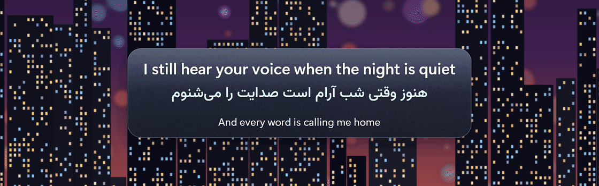
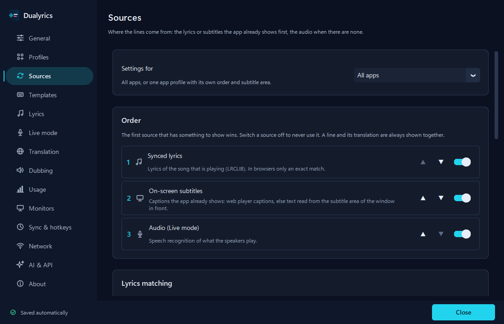
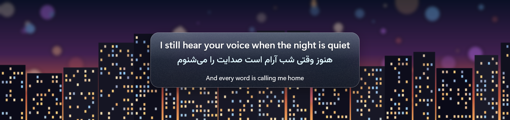
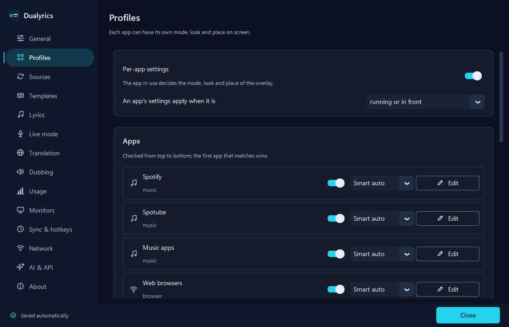
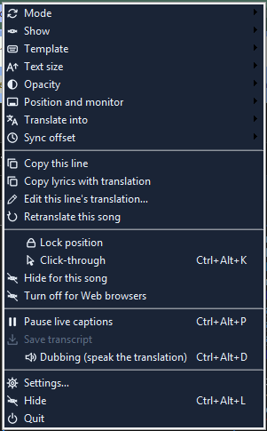
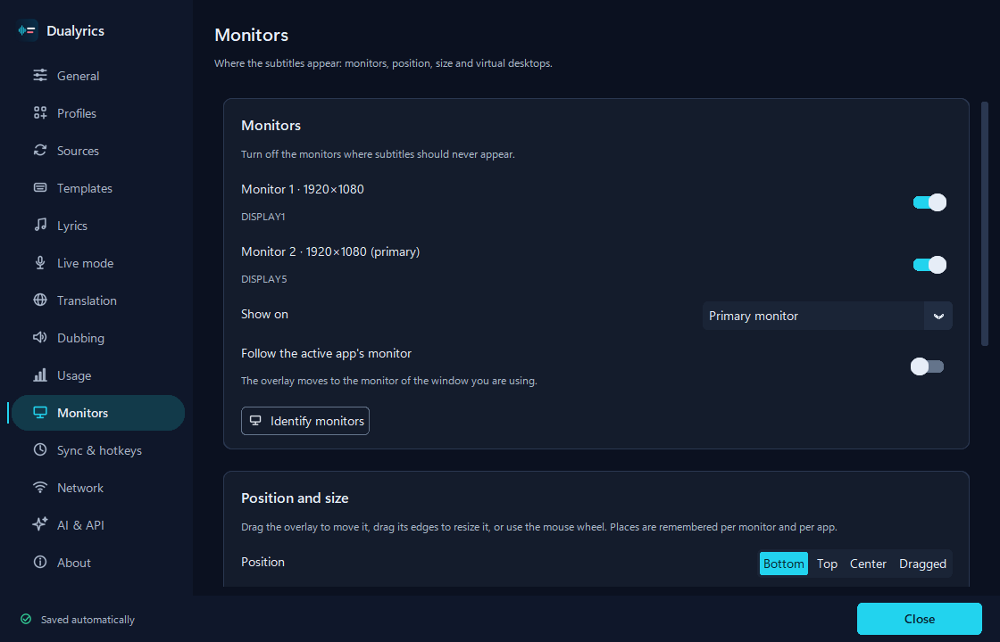
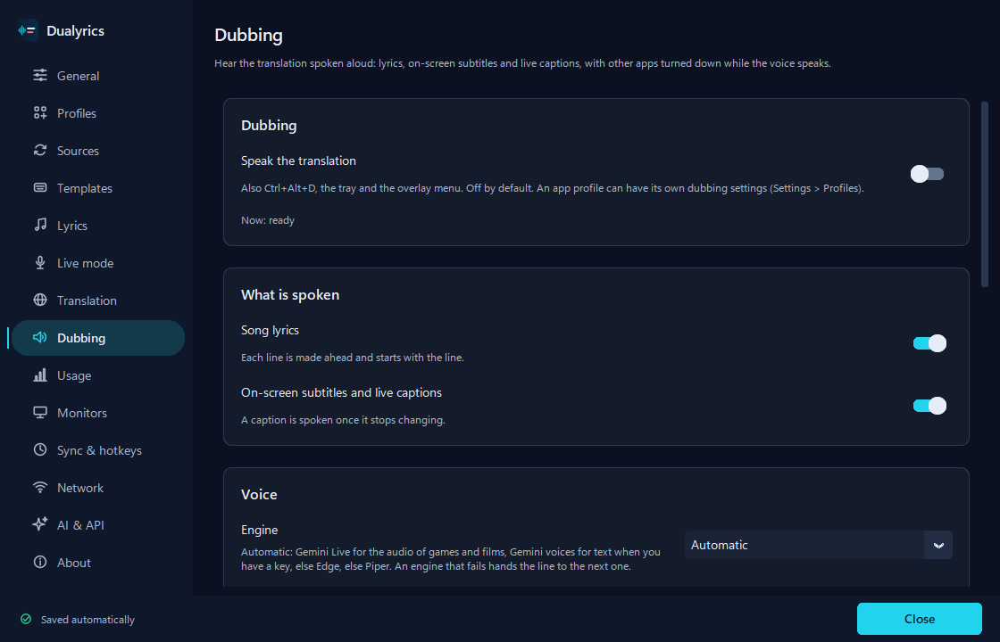
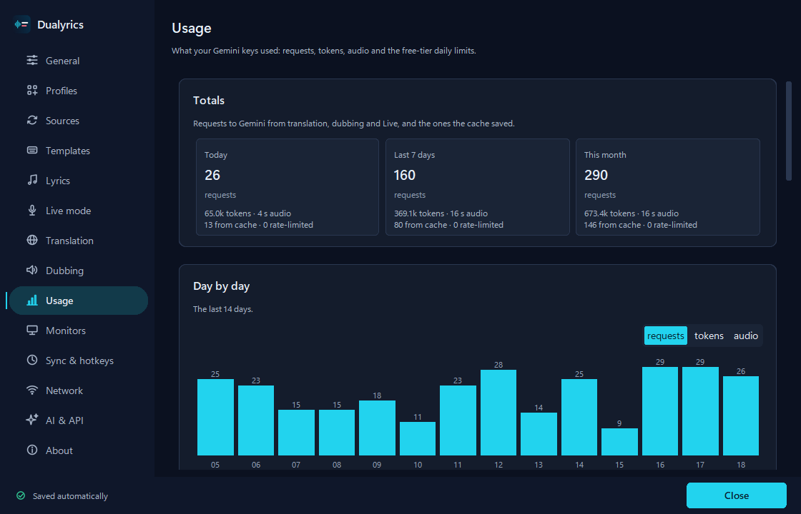
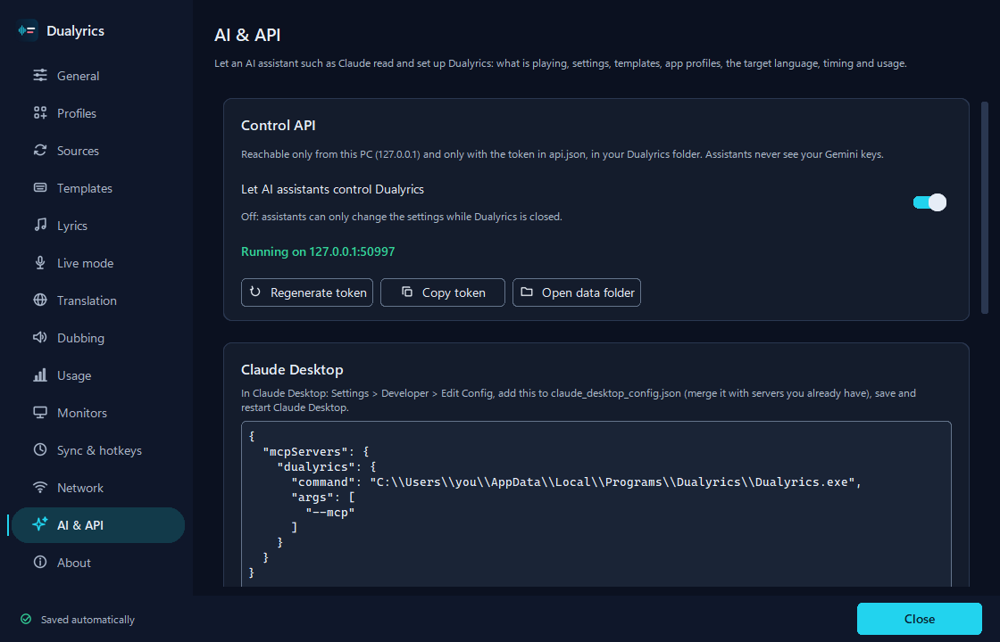

<p align="center"></p>

<h1 align="center">Dualyrics</h1>

<p align="center"><b>Live translated subtitles for anything you hear on Windows: songs, YouTube, games and films.</b><br>
Any language you hear → English + your own language. 40+ target languages.</p>

<p align="center">
<a href="https://github.com/morpheusadam/Dualyrics/releases/latest"></a>
<a href="https://github.com/morpheusadam/Dualyrics/releases"></a>
<a href="https://github.com/morpheusadam/Dualyrics/stargazers"></a>
<a href="LICENSE"></a>

</p>

<p align="center">

</p>

<p align="center">
<a href="https://github.com/morpheusadam/Dualyrics/releases/latest"><b>Download for Windows</b></a> ·
<a href="#quick-start">Quick start</a> ·
<a href="#faq">FAQ</a> ·
<a href="README.fa.md">فارسی</a>
</p>

If Dualyrics helps you understand a song, a video or a game, please **star the repository**. Stars help other people find it, and they count as votes for the [Linux version](#roadmap).

## What is Dualyrics?

Dualyrics is a free, open-source Windows 10/11 app that puts a translation under whatever you are listening to, in a small always-on-top subtitle bar. For music it shows time-synced lyrics from [LRCLIB](https://lrclib.net) line by line, with the translation under each line. For YouTube, films and games it reads the subtitles already on screen, or listens to the sound and writes captions with offline speech recognition (Whisper). Speech or text in any language is turned into English first, then into your language, so a Japanese anime, a German game or a Korean song all end up in Persian, Turkish, Spanish or any of 46 target languages. Translation uses Google Gemini with your own free API key, or free Google Translate with no key at all. There is no account, no login and no telemetry.

Contents: [Quick start](#quick-start) · [Free Gemini key](#get-a-free-gemini-api-key) · [Use cases](#what-you-can-use-it-for) · [Smart sources](#how-dualyrics-picks-what-to-show) · [Any language](#any-language-to-english-and-your-language) · [Live mode](#live-mode) · [Templates](#templates) · [Profiles](#per-app-profiles) · [Monitors](#monitors-and-the-overlay) · [Dubbing](#dubbing) · [Usage meter](#gemini-usage-meter) · [AI and MCP](#ai-assistants-and-mcp) · [Privacy](#privacy) · [FAQ](#faq) · [Roadmap](#roadmap) · [Contributing](#contributing)

## Quick start

1. Download `Dualyrics-Setup-2.1.0.exe` from the [latest release](https://github.com/morpheusadam/Dualyrics/releases/latest) and run it. Setup is in English or Persian, needs no admin rights and installs for your Windows user only, into `%LOCALAPPDATA%\Programs\Dualyrics`.
2. Dualyrics starts when Setup finishes, and the settings window opens the first time.
3. Pick your language in **Settings › General › Translate into**, then play a song on Spotify or a video on YouTube.

That is enough for lyrics and on-screen subtitles. For captions from the sound itself (games and videos without subtitles), add [Live mode](#live-mode) once.

Prefer a portable copy? The release also has `Dualyrics.exe` (one file, no installation) and `Dualyrics-2.1.0-windows-x64.zip`. `SHA256SUMS.txt` lists the checksum of every file. Windows SmartScreen may warn about an unsigned app from a new publisher: choose **More info › Run anyway** if you trust the download, or [build it yourself](#build-from-source).

Upgrading keeps your settings: run the new Setup over the old version. Uninstall from **Windows Settings › Apps › Installed apps › Dualyrics**; the uninstaller asks whether to delete your settings too (the default keeps them). For scripts: `Dualyrics-Setup-2.1.0.exe /VERYSILENT /SUPPRESSMSGBOXES /TASKS="desktopicon,startup"`.

## Get a free Gemini API key

Dualyrics works without any key, through the free Google Translate endpoint. A Gemini key gives better translations of slang, idioms and wordplay, because Gemini gets the whole song (or the last few caption lines) at once. The key is free:

1. Open [Google AI Studio › API keys](https://aistudio.google.com/apikey) and sign in with a Google account.
2. Click **Create API key**. Pick an existing Google Cloud project or let AI Studio create one.
3. Copy the key (it starts with `AIza`).
4. In Dualyrics open **Settings › Translation**, set **Translation provider** to **Gemini**, paste the key into the keys box and press **Test**.

The free tier has daily request limits per model, which Google sets and changes from time to time. A song normally costs one request, translations are cached, and songs already in your language are skipped. You can add several keys and models: when one reaches its limit, Dualyrics moves to the next, and with **Use the free translator when Gemini fails** on, it falls back to Google Translate. Keys are encrypted with Windows DPAPI for your Windows user and never leave your PC except in requests to Google. **Settings › Usage** shows how much of each daily limit you have used.

## What you can use it for

### Music: Spotify, YouTube Music, Spotube

Play a song and Dualyrics shows the current line, its translation and the next line, in time with the music. It reads the track from Windows media controls, so it works with the Spotify desktop app, Spotube, the Windows Media Player app, and YouTube or YouTube Music in Chrome, Edge, Firefox, Brave or Opera. Lyrics come from LRCLIB; lyrics without timing are shown as a list you can scroll. Fix early or late lyrics with `Ctrl+Alt+Up` and `Ctrl+Alt+Down`; the offset is remembered per song.

<p align="center"></p>

### YouTube and other videos in the browser

For a music video, Dualyrics looks up synced lyrics, but in a browser it accepts only an exact match (title, artist and length within a few seconds), so a cooking video called "Pasta" never gets the lyrics of a song called "Pasta". For any other video it reads the captions the player shows. In Chrome and Edge, YouTube's caption text is read directly through Windows UI Automation, with no OCR. If the video has no captions, Live mode captions the sound.

### Games

Many games show their own subtitles. Dualyrics reads them from the screen with the offline OCR built into Windows: draw a rectangle around the subtitle area once (**Settings › Sources › Pick on a window…**) and it reads only that area, only when it changes, and ignores text that never changes, such as HUD labels. When a game has no subtitles, Live mode listens to the game's sound instead. The **Games** profile turns on click-through, so the overlay never steals a mouse click. Run games in Borderless or Windowed mode, because no window can be drawn over exclusive fullscreen.

<p align="center"></p>

### Films and series

In VLC, MPC-HC/BE, PotPlayer or a browser, Dualyrics translates the film's own subtitles from the screen or captions what the actors say. Each line is translated together with the few lines before it, so names and terms stay the same through the film.

<p align="center"></p>

## How Dualyrics picks what to show

For the app in front of you, Dualyrics uses the lines that app already provides and listens to the sound only when there are none. It tries three sources in order and shows the first one that has something:

| Order | Source | Used for | How it works |
|---|---|---|---|
| 1 | Synced lyrics | Songs in Spotify, Spotube, music apps, browsers | LRCLIB lookup by title, artist, album and length; exact match only in browsers |
| 2 | On-screen subtitles | YouTube captions, film subtitles, game subtitles | Windows UI Automation for web players in Chrome and Edge, otherwise offline Windows OCR of the subtitle area, 1 to 6 times a second |
| 3 | Audio (Live mode) | Anything without lyrics or subtitles | Speaker audio cut at pauses, recognised offline with Whisper |

You can reorder the sources or switch one off, for all apps or for one app profile, in **Settings › Sources**. The full decision table, with the timing rules and the hysteresis that stops flicker, is in [docs/ALGORITHM.md](docs/ALGORITHM.md).

<p align="center"></p>

OCR needs the OCR pack of the subtitle language in Windows (**Settings › Time & language › Language & region › your language › Language options › Optical character recognition**). English is usually installed already.

## Any language to English and your language

With **Pivot through English** (on by default), speech and text in any language go through English. Whisper's multilingual model translates speech to English offline on your PC, and on-screen text in another language is translated to English by the translator. Then the English is translated into your target language. Turn on **Also show the original-language line** to see the line as it was said, with the English as a small third line under the translation.

<p align="center"></p>

The target can be any of 46 languages, including Persian, Arabic, Turkish, Spanish, Portuguese, French, German, Italian, Russian, Ukrainian, Hindi, Urdu, Bengali, Indonesian, Japanese, Korean and Chinese. Persian, Arabic, Hebrew, Urdu, Sorani Kurdish and Pashto are laid out right to left, with letters shaped by Windows so they always join. The Vazirmatn font is bundled.

## Live mode

Live mode turns whatever your speakers play into subtitles. It records the speaker output (WASAPI loopback), cuts it at natural pauses, recognises speech with [faster-whisper](https://github.com/SYSTRAN/faster-whisper) on your NVIDIA GPU or CPU, and shows the translation a moment later. Typical Whisper mistakes, such as "Thank you for watching" during silence or music, are filtered out.

Live mode's speech packages (about 150 MB, or about 1 GB more with NVIDIA GPU support) are not inside the exe, so the app stays near 25 MB and starts fast. To add them:

1. Open **Settings › Live mode** and click **Install Live mode**. Tick the NVIDIA option if you have an NVIDIA card. The installed app puts the packages in `%APPDATA%\Dualyrics\live-runtime` and needs [Python 3.12](https://www.python.org/downloads/) on the PC once, only to run that download. From source, run `pip install -e .[live]` or `.[live-gpu]` instead.
2. Pick a speech model: `small` is a good default, `tiny` and `base` are lighter, `medium` wants a GPU. Turn on **English-only model** for English games and films. The model downloads once, on first use, into `%APPDATA%\Dualyrics\models`.

In Smart auto mode, live captions start by themselves for fullscreen games, apps added as **Game**, and songs or videos without lyrics or subtitles. Pause with `Ctrl+Alt+P`.

<p align="center"></p>

## Templates

A template is one JSON file that describes the whole look: fonts per script, colours or gradients, outline, up to four soft shadows or glows, the box, line order, karaoke highlight and motion. Nine looks are built in: **Liquid Glass** (the default), Cinema, Netflix, Karaoke, Minimal, Neon, Game HUD, Glass and Persian Classic. Liquid Glass blurs what is behind the box for real, with the Windows acrylic effect, and adds a bright rim and soft depth.

<p align="center"></p>

Edit any look in **Settings › Templates** with a live preview over dark, bright and busy game scenes and a contrast check per line. Editing a built-in look makes your own copy, and **Reset to preset** always works. Templates can be duplicated, renamed, deleted with undo, and exported or imported as `.json` to share. Imported files are checked against the schema in [docs/DESIGN.md](docs/DESIGN.md#26-json-schema). Sizes follow the screen height, so a template looks the same at 1080p, 1440p and 4K.

<p align="center">


</p>

## Per-app profiles

Each app can have its own mode (Smart auto, Lyrics, Live or Off), template, target language, source order, subtitle area, monitor, position, width, click-through, translation-only and dubbing settings. Profiles for Spotify, Spotube, music apps, web browsers, VLC, MPC-HC/BE and PotPlayer come built in, with a **Games** preset for fullscreen apps. Add an app from the running ones, by picking its `.exe`, or by clicking its window. The first profile that matches, from the top of the list, wins. The list can be exported and imported.

<p align="center"></p>

## Monitors and the overlay

Drag the overlay to move it, drag a left or right edge to reflow the text, drag the top, bottom or a corner to scale it, or use the mouse wheel. Position and size are remembered per monitor and per app. Choose which monitors the overlay may use, let it follow the monitor of the app you are using, or send it to another monitor from the right-click menu; it comes back on screen when a monitor is unplugged. It can follow you to every virtual desktop or stay on one.

The right-click menu has the mode, which lines to show, template, text size, opacity, position and monitor, target language, sync offset, copy the line or the whole song with its translation, edit one line's translation, retranslate, lock, click-through, hide for this song or app, pause live captions and dubbing. With click-through on, the overlay ignores the mouse; `Ctrl+Alt+K` turns it off again.

<p align="center">


</p>

## Dubbing

Dubbing reads the translation aloud. It is off by default; turn it on in **Settings › Dubbing**, from the tray, from the overlay menu or with `Ctrl+Alt+D`. Lyrics lines are prepared ahead and start with the line; captions are spoken once they stop changing. While the voice speaks, other apps are turned down (by 60 % by default) and get their volume back afterwards.

| Voice engine | Cost | Notes |
|---|---|---|
| Gemini voices | Free tier of your Gemini key | Text to speech with the `*-tts` models your key offers |
| Gemini Live | Free tier of your Gemini key | Speech to speech for games and films: the captured audio goes to Gemini, which speaks the translation back with the lowest delay |
| Microsoft Edge voices | Free, online | Needs the small `edge-tts` package, one click to install |
| Piper | Free, offline | About 20 MB plus 20 to 60 MB per voice, one click to install |

**Automatic** picks Gemini Live for game and film audio and Gemini voices for text when you have a key, otherwise Edge, otherwise Piper. An engine that fails hands the line to the next one.

<p align="center"></p>

## Gemini usage meter

**Settings › Usage** counts every Gemini request Dualyrics makes, for translation, dubbing and Gemini Live: requests, tokens, seconds of audio, rate-limit errors and cache hits, per day, per model, per key and per song or video. It shows today's share of each free-tier daily limit and when the quota resets (midnight Pacific time), and warns at 80 %. Keys are named by their position (#1, #2), never by the key itself. The data stays in `%APPDATA%\Dualyrics\usage.sqlite` and can be exported as CSV.

<p align="center"></p>

## AI assistants and MCP

Claude Desktop, Claude Code and other assistants that speak the Model Context Protocol (MCP) can read and set up Dualyrics. Ask "set the Game HUD template for God of War", "translate to Turkish", "the lyrics are half a second early" or "show my Gemini usage". The MCP server is built in: `Dualyrics.exe --mcp`.

Claude Desktop (**Settings › Developer › Edit Config**, `claude_desktop_config.json`):

```json
{
  "mcpServers": {
    "dualyrics": {
      "command": "C:\\Users\\<you>\\AppData\\Local\\Programs\\Dualyrics\\Dualyrics.exe",
      "args": ["--mcp"]
    }
  }
}
```

Claude Code:

```powershell
claude mcp add dualyrics --scope user -- "C:\Users\<you>\AppData\Local\Programs\Dualyrics\Dualyrics.exe" --mcp
```

Cursor, VS Code, Windsurf, Zed and other clients use the same command and argument. **Settings › AI & API** shows the exact text for your PC with Copy buttons.

The 20 tools cover status (what is playing and the lines on screen), settings (validated patches, all or nothing), templates, app profiles, mode, target language, sync offset, retranslate, correcting a line's translation, Gemini usage, dubbing and show or hide. They talk to the running app through a local control API on `127.0.0.1` only, with a bearer token stored in `%APPDATA%\Dualyrics\api.json`. Web pages cannot reach it, and assistants never see or change your Gemini keys. You can switch the API off on the same page. Tools, examples, the HTTP API for scripts and the security model: [docs/AI.md](docs/AI.md).

<p align="center"></p>

## Privacy

Dualyrics has no account, no telemetry, no analytics and no update check. Speech recognition and OCR run on your PC. It makes only these requests, through the proxy you choose:

| Service | What is sent | When |
|---|---|---|
| LRCLIB (`lrclib.net`) | Song title, artist, album and length | To find lyrics for a new song |
| Google Gemini API | Lyric or caption lines, the song title or app name, a few earlier lines for context, the target language, your style text and your API key | When the provider is Gemini and the line is not cached |
| Google Translate (`translate.googleapis.com`) | Lyric or caption lines and the target language | In free mode, or as the fallback |
| Google Gemini API (dubbing) | Translated lines to speak; with Gemini Live, the captured speaker audio | Only with dubbing on and a Gemini engine chosen |
| Microsoft Edge voices | Translated lines to speak | Only with dubbing on and the Edge engine |
| Hugging Face, GitHub | Download of the chosen Whisper model or Piper voice | Once, on first use |
| PyPI | pip download of the Live mode or Edge voice packages | Only when you click Install |

Everything else stays in `%APPDATA%\Dualyrics`: settings (Gemini keys encrypted with DPAPI), cache, models, usage data, transcripts (only with **Save transcripts**), `api.json` and logs. The screen picture used for OCR never leaves your PC. To remove everything, uninstall and answer **Yes** when asked about your settings.

## FAQ

### How do I translate game subtitles in real time on PC?

Install Dualyrics, open **Settings › Sources**, click **Pick on a window…** and drag a rectangle around the game's subtitle area. Dualyrics then reads that area with offline Windows OCR whenever it changes and shows the translation in an overlay over the game. If the game has no subtitles, install Live mode once: it listens to the game's sound, recognises speech with Whisper and shows a translated caption a second or two later. Use Borderless or Windowed mode.

### How can I translate a YouTube video in any language?

Play the video in Chrome or Edge with Dualyrics running. If YouTube shows captions (including auto-generated ones), Dualyrics reads them through Windows UI Automation and translates each line into your language. If there are no captions, Live mode captions the sound. With Pivot through English on, a video in Japanese, Korean, Hindi or any other language Whisper knows is turned into English first and then into your language.

### How do I see Spotify lyrics translated?

Play a song in the Spotify desktop app while Dualyrics runs. Spotify reports the track to Windows media controls, and Dualyrics shows the synced lyrics from LRCLIB in its own window on top, with a translation under each line. You do not sign in to anything, and Spotify's own lyrics panel is not needed.

### Can I translate Spotify lyrics into Persian, Turkish or another language?

Yes. Choose the language in **Settings › General › Translate into**: 46 languages are available, from Persian and Arabic to Spanish, German, Russian, Hindi, Japanese, Korean and Chinese. For the most natural result add a free Gemini key; without one, free Google Translate is used.

### How do I get synced lyrics with translation for YouTube Music on Windows?

Play YouTube Music in Chrome, Edge, Firefox, Brave or Opera. The browser passes the title to Windows media controls, Dualyrics cleans titles such as "Artist - Song (Official Video)", finds the synced lyrics on LRCLIB and shows the translation under each line.

### Can I watch a film without subtitles in my language?

Yes. If the film has subtitles in a language you do not read, Dualyrics translates them from the screen. If it has none, Live mode captions the dialogue and translates it, in VLC, MPC-HC, PotPlayer, a browser or any other player.

### Is Dualyrics free? Do I need an API key?

Dualyrics is free and MIT licensed. No key is needed, because the default translator is free Google Translate. A Gemini key from Google AI Studio is optional and also free within Google's daily limits.

### Does Live mode send my audio to the internet? Will it slow down my game?

No audio leaves your PC in Live mode: speech recognition runs offline, and only the recognised text is sent for translation. (Dubbing with the Gemini Live engine is the one feature that sends audio, and it is off by default.) On an NVIDIA card Whisper uses the GPU and some video memory; on the CPU, `tiny` or `base` is the better choice while you play. Pause any time with `Ctrl+Alt+P`.

### Can Dualyrics read the translation aloud?

Yes, with [Dubbing](#dubbing). It speaks lyrics and captions in your language with Gemini, Microsoft Edge or offline Piper voices and turns other apps down while it speaks.

### The lyrics are early or late. How do I fix the timing?

Press `Ctrl+Alt+Up` to show lyrics later or `Ctrl+Alt+Down` to show them earlier, 250 ms per press. Dualyrics remembers the offset for that song. A global offset is in **Settings › Sync & hotkeys**.

### Does it work on macOS or Linux?

Not yet. Dualyrics uses Windows media controls, Windows OCR and Win32 windows. A Linux version is on the [roadmap](#roadmap), and stars decide it.

### Do I need Python?

No. The installer and the portable exe contain everything for lyrics, on-screen subtitles, translation and dubbing. Only the one-time Live mode download in the installed app uses Python 3.12 from python.org, to run pip.

## Roadmap

- **Linux version: we review stars on 2026-12-17. Every star is a vote.** If the repository has grown enough by then, a Linux build (PipeWire capture, MPRIS for now playing) is next. [Star Dualyrics](https://github.com/morpheusadam/Dualyrics/stargazers) if you want it.
- More interface languages beyond English and Persian (translations are welcome, see [Contributing](#contributing)).
- Word-by-word karaoke where lyrics have word timing.
- Your ideas: open a [feature request](https://github.com/morpheusadam/Dualyrics/issues/new/choose).

<p align="center"><a href="https://github.com/morpheusadam/Dualyrics/stargazers"></a></p>

## Configuration

Every option applies at once and is saved automatically to `%APPDATA%\Dualyrics\settings.json`. The settings window has these sections: General, Profiles, Sources, Templates, Lyrics, Live mode, Translation, Dubbing, Usage, Monitors, Sync & hotkeys, Network, AI & API and About. Set the `DUALYRICS_HOME` environment variable to keep all data in another folder (for a portable copy).

<details>
<summary>All settings (<code>settings.json</code> keys)</summary>

| Key | Section | Default | What it does |
|---|---|---|---|
| `target_language` | General | Your Windows language | Language of the translation (46 choices) |
| `ui_language` | General | Persian on a Persian Windows, else English | Interface language: `en` or `fa` |
| `ui_theme` | General | `dark` | `dark`, `light` or `system` |
| `mode` | General | `auto` | `auto` (Smart auto), `lyrics` or `live` |
| `translation_only` | General | Off | Hide the original line when a translation exists |
| `start_with_windows` | General | Off | Adds Dualyrics to `HKCU\...\CurrentVersion\Run`; no admin rights |
| `profiles_enabled`, `profile_activation` | Profiles | On, `running` | Per-app profiles, and whether they apply while the app runs or only in front |
| `source_order`, `sources_off` | Sources | lyrics, screen, audio | Source order and the sources switched off |
| `lyrics_strict_browsers`, `lyrics_strict_tolerance` | Sources | On, `4` | Exact lyrics match in browsers, with a length tolerance in seconds |
| `screen_uia`, `screen_ocr`, `ocr_language`, `ocr_fps` | Sources | On, On, `auto`, `3.5` | On-screen subtitle readers, OCR language and reads per second |
| `pivot_english`, `pivot_show_original` | Sources | On, Off | Any language through English; also show the original-language line |
| `template` | Templates | `liquid_glass` | The active template |
| `hide_when_idle`, `idle_hide_delay` | Lyrics | On, `3` | Hide when nothing plays, after this many seconds |
| `show_original`, `show_translation`, `show_next` | Lyrics | On | Which lines are shown |
| `preferred_players` | Lyrics | `spotify, spotube, zunemusic, chrome, msedge, firefox, brave, opera, vlc` | Which player wins when several play |
| `live_enabled`, `live_when_no_lyrics` | Live | On, On | Live captions, also for songs and videos without lyrics |
| `live_model`, `live_english_only`, `live_device` | Live | `small`, Off, `auto` | Whisper model, English-only variant, `cpu` or `gpu` |
| `live_source_language` | Live | `auto` | Spoken language, or automatic |
| `live_vad_sensitivity`, `live_max_segment` | Live | `5`, `6` | Voice sensitivity (1 to 10) and the longest piece in seconds |
| `live_reading_cps`, `live_min_display`, `live_context_lines` | Live | `17`, `1.5`, `4` | Reading speed, shortest time on screen, earlier lines sent for context |
| `live_save_transcripts` | Live | Off | Save captions to `transcripts\YYYY-MM-DD.txt` |
| `provider` | Translation | `free` | `gemini` or `free` (Google Translate) |
| `gemini_keys`, `gemini_models` | Translation | empty, four Flash models | Keys and models, tried in order; keys stored encrypted |
| `fallback_free`, `skip_same_language`, `style` | Translation | On, On, a song-translator instruction | Free fallback, skip songs already in your language, style text for Gemini |
| `dub_enabled`, `dub_engine`, `dub_voice` | Dubbing | Off, `auto`, `auto` | Dubbing, voice engine and voice |
| `dub_speed`, `dub_volume`, `dub_duck`, `dub_duck_amount` | Dubbing | `1.0`, `90`, On, `60` | Voice speed and volume; turn other apps down, by how much |
| `dub_lyrics`, `dub_captions` | Dubbing | On, On | What is spoken |
| `usage_limits`, `usage_warn` | Usage | estimates, On | Daily request limits per model, warning at 80 % |
| `monitors_off`, `monitor`, `follow_active_monitor` | Monitors | none, primary, Off | Where the overlay may go |
| `position_preset`, `overlay_scale`, `overlay_opacity` | Monitors | `bottom`, `1.0`, `1.0` | Position, text size and opacity |
| `locked`, `click_through`, `virtual_desktops` | Monitors | Off, Off, `all` | Lock, click-through, all or current virtual desktop |
| `offset_ms`, `offset_step_ms` | Sync | `0`, `250` | Global offset (+ shows lyrics later) and the hotkey step |
| `hotkey_*` | Sync | `ctrl+alt+up/down/l/k/p/d` | Offset later and earlier, show or hide, click-through, pause Live, dubbing |
| `proxy_mode`, `proxy_url` | Network | `system`, empty | `none`, `system` or `custom` (`http://` or `socks5://`) |
| `api_enabled` | AI & API | On | Local control API for AI assistants |

</details>

## Troubleshooting

| Problem | What to try |
|---|---|
| "Network error" or no lyrics at all | **Settings › Network › Test connection**. If LRCLIB or Google is blocked where you are, set a proxy (`socks5://127.0.0.1:<port>` or `http://127.0.0.1:<port>`) |
| "Translation failed (quota, key or network)" | Press **Test** under Translation, add another key or model, or turn on the free fallback; then right-click the overlay and choose **Retranslate this song** |
| The overlay follows the wrong player | Put your player first in **Lyrics › Preferred players** |
| Nothing shows for a song | Check that the song appears in the Windows media flyout; if not, the player does not report to Windows |
| No subtitles read from a game | Draw the subtitle area in **Settings › Sources** and use **Test on a window…**; install the Windows OCR pack of the language |
| No live captions over a game | Use Borderless or Windowed mode; check that **Settings › Live mode** says "Installed" and the sound plays on the default output device |
| The overlay ignores the mouse | Click-through is on: press `Ctrl+Alt+K` |
| Anything else | Start with `--debug` and open the log from **About › Open log** |

## Build from source

Requirements: Windows 10 or 11 and Python 3.10 or newer.

```powershell
git clone https://github.com/morpheusadam/Dualyrics.git
cd Dualyrics
python -m venv .venv
.venv\Scripts\pip install -r requirements.txt
.venv\Scripts\pythonw run.pyw
```

Build the exe, the zip and the installer with `powershell -ExecutionPolicy Bypass -File tools\build.ps1 -Install` (it runs the tests, PyInstaller and [Inno Setup](https://jrsoftware.org/isinfo.php) 6.3+). Pushing a `v*` tag builds the same files on GitHub Actions and attaches them to a release. Command-line options: `--settings`, `--debug`, `--quit`, `--mcp`, `--version`.

## Contributing

Bug reports, interface translations, new templates and pull requests are welcome. Read [CONTRIBUTING.md](CONTRIBUTING.md), pick one of the [good first issues](docs/GOOD_FIRST_ISSUES.md), and run the tests with `.venv\Scripts\python -m pytest`. Please follow the [code of conduct](CODE_OF_CONDUCT.md), and report security problems privately as described in [SECURITY.md](SECURITY.md). Changes are listed in [CHANGELOG.md](CHANGELOG.md); the design system and the decision rules are in [docs/DESIGN.md](docs/DESIGN.md) and [docs/ALGORITHM.md](docs/ALGORITHM.md).

## Credits

- Lyrics from [LRCLIB](https://lrclib.net), a free and open lyrics database. Please support it and add lyrics it is missing.
- Speech recognition with [faster-whisper](https://github.com/SYSTRAN/faster-whisper) and the Whisper models converted by SYSTRAN; loopback capture with [PyAudioWPatch](https://github.com/s0d3s/PyAudioWPatch); offline voices with [Piper](https://github.com/rhasspy/piper).
- Interface with [CustomTkinter](https://github.com/TomSchimansky/CustomTkinter), [pystray](https://github.com/moses-palmer/pystray) and [Pillow](https://python-pillow.org); Windows APIs through [PyWinRT](https://github.com/pywinrt/pywinrt) and [comtypes](https://github.com/enthought/comtypes). The [Vazirmatn](https://github.com/rastikerdar/vazirmatn) font is bundled under the SIL Open Font License.
- The installer is built with [Inno Setup](https://jrsoftware.org/isinfo.php).

Lyrics are copyright of their owners. Dualyrics only displays lyrics fetched from LRCLIB on your own computer.

## License

[MIT](LICENSE). Copyright (c) 2026 [morpheusadam](https://github.com/morpheusadam) and Dualyrics contributors.

Made by [morpheusadam](https://github.com/morpheusadam). If Dualyrics is useful to you, a [star](https://github.com/morpheusadam/Dualyrics/stargazers) is the best thanks.
