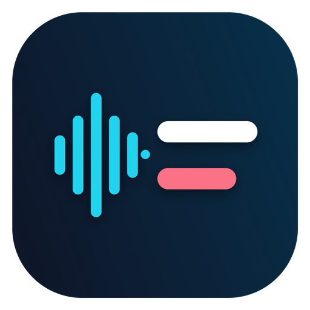
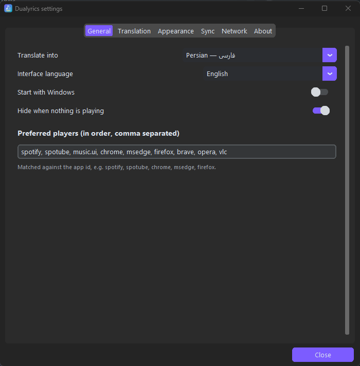
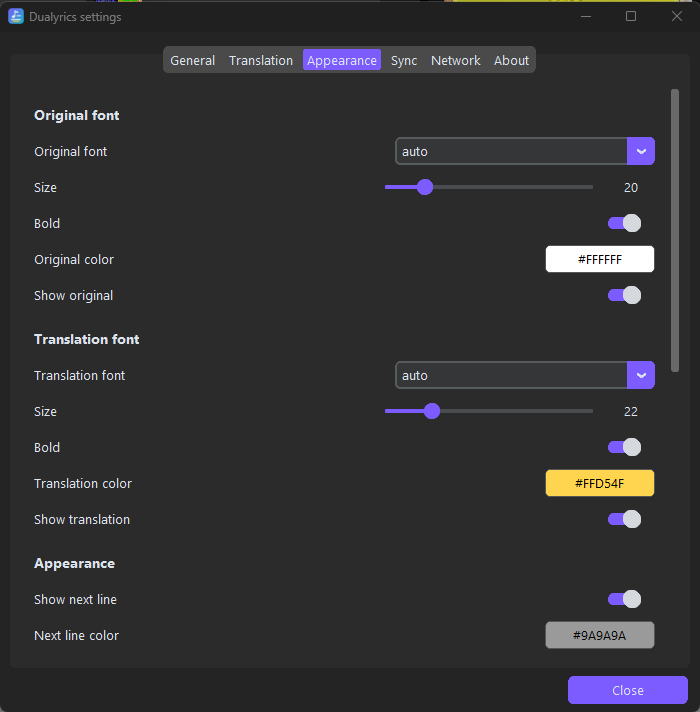

<p align="center"></p>

<h1 align="center">Dualyrics</h1>

<p align="center"><b>Synced lyrics with a translation under every line, in a floating window on Windows.</b><br>
For Spotify, Spotube, YouTube Music, YouTube in the browser and any player that shows up in Windows media controls.</p>

<p align="center">
<a href="../../releases/latest"></a>


<a href="LICENSE"></a>
<a href="https://lrclib.net"></a>
</p>

<p align="center">

</p>

<p align="center"><a href="README.fa.md">فارسی</a></p>

## What is Dualyrics?

Dualyrics is a free, open-source Windows 10/11 app that shows the lyrics of the song you are playing, line by line and in time with the music, with a translation under each line. It reads the current track from Windows media controls, downloads time-synced lyrics from [LRCLIB](https://lrclib.net), translates the whole song in one request with Google Gemini (your own free API key) or with free Google Translate (no key), and draws a small always-on-top bar over your other windows. It works with Spotify desktop, Spotube, and YouTube or YouTube Music in Chrome, Edge, Firefox, Brave or Opera. It does not need a Spotify account or any login.

Contents: [Features](#features) · [Quick start](#quick-start) · [Using the overlay](#using-the-overlay) · [Configuration](#configuration) · [How it works](#how-it-works) · [Supported players](#supported-players) · [FAQ](#faq) · [Privacy](#privacy) · [Troubleshooting](#troubleshooting) · [Contributing](#contributing)

## Features

- Time-synced lyrics from LRCLIB: the current line, its translation, and the next line in grey. Lyrics without timing are shown as a list you can scroll.
- Translation into 46 languages. Gemini gets the whole song at once, so idioms, slang and wordplay are translated in context. Free Google Translate mode needs no key.
- Right-to-left layout for Persian, Arabic, Hebrew, Urdu, Kurdish (Sorani) and Pashto. Vazirmatn is used automatically when it is installed.
- Songs already in your target language are not translated, which saves Gemini quota.
- Several Gemini keys and models. When one hits its quota, Dualyrics moves to the next, and it can fall back to the free translator.
- A customizable window: fonts, sizes, bold, colours, background colour and opacity, a transparent "text only" mode with outline and shadow, width, alignment, rounded corners (Windows 11), top/center/bottom presets, position lock and click-through.
- Sync controls: a global offset, a per-song offset that is remembered, and global hotkeys (`Ctrl+Alt+Up`, `Ctrl+Alt+Down`, `Ctrl+Alt+L`) that you can change.
- System tray icon, optional start with Windows, and a remembered window position for each monitor.
- Proxy support for LRCLIB and translation requests: no proxy, the system proxy, or a custom `http://` or `socks5://` proxy, with a connection test.
- English and Persian interface.
- No account and no telemetry. Settings, cache and logs stay in `%APPDATA%\Dualyrics`, and Gemini keys are encrypted with Windows DPAPI for your Windows user.

<p align="center">

</p>

## Quick start

### Download the app

1. Download `Dualyrics.exe` from the [latest release](../../releases/latest). The same file also comes in `Dualyrics-<version>-windows-x64.zip` with the README and license, and `SHA256SUMS.txt` lets you check the download.
2. Run it. It is a single portable file and needs no installation. The settings window opens on the first start.
3. Pick your language under **General › Translate into** and play a song.

Windows SmartScreen may warn about an unsigned app from a new publisher. Choose **More info › Run anyway** if you trust the download, or build it yourself from source.

### Run from source

Requirements: Windows 10 or 11 and Python 3.10 or newer.

```powershell
git clone <repository-url> Dualyrics
cd Dualyrics
python -m venv .venv
.venv\Scripts\pip install -r requirements.txt
.venv\Scripts\pythonw run.pyw
```

You can also install it as a package and start it with the `dualyrics` command:

```powershell
pip install .
dualyrics
```

Command-line options: `--settings` opens the settings window on start, `--debug` writes a verbose log, `--version` prints the version. Starting Dualyrics a second time opens the settings window of the copy that is already running.

### Build the .exe yourself

```powershell
.venv\Scripts\pip install -r requirements-build.txt
powershell -ExecutionPolicy Bypass -File tools\build.ps1
```

`tools\build.ps1` runs the tests, then PyInstaller with `Dualyrics.spec`. It writes `dist\Dualyrics.exe`, `dist\Dualyrics-<version>-windows-x64.zip` and `dist\SHA256SUMS.txt`. Pushing a `v*` tag runs the same build on GitHub Actions and attaches these files to a GitHub Release. Changes are listed in [CHANGELOG.md](CHANGELOG.md).

### Get a free Gemini key (optional, better translations)

1. Open [Google AI Studio](https://aistudio.google.com/) and choose **Get API key**.
2. In **Settings › Translation**, choose **Gemini**, paste the key and press **Test**.

Without a key, Dualyrics uses free Google Translate.

## Using the overlay

| Action | Result |
|---|---|
| Drag | Moves the bar (unless the position is locked) |
| Mouse wheel | Makes the text bigger or smaller. On unsynced lyrics it scrolls, and `Ctrl` + wheel resizes |
| Double-click | Shows or hides the next line |
| Right-click | Menu: settings, retranslate, song offset, show/hide original, translation and next line, text only, lock, click-through, position, hide, quit |
| Tray icon | Show lyrics, settings, retranslate, click-through, lock position, open cache folder, quit. Left-click opens settings |

With click-through on, the bar ignores the mouse. Turn it off again from the tray icon.

<p align="center">


</p>

## Configuration

Every option applies immediately. The settings window has six tabs: General, Translation, Appearance, Sync, Network and About. Settings are saved to `%APPDATA%\Dualyrics\settings.json`. Set the `DUALYRICS_HOME` environment variable to keep all data in another folder (for a portable copy).

| Setting (`settings.json` key) | Where | Default | What it does |
|---|---|---|---|
| `target_language` | General | Your Windows language | Language of the translation (46 choices) |
| `ui_language` | General | Persian on a Persian Windows, otherwise English | Interface language: `en` or `fa` |
| `start_with_windows` | General | Off | Adds Dualyrics to `HKCU\...\CurrentVersion\Run`; no admin rights needed |
| `hide_when_idle` | General | On | Hides the bar when nothing is playing |
| `idle_hide_delay` | file only | `3` | Seconds to wait before hiding (0 to 60) |
| `preferred_players` | General | `spotify, spotube, zunemusic, chrome, msedge, firefox, brave, opera, vlc` | Which player wins when several are playing, matched against the app id |
| `provider` | Translation | `free` | `gemini` or `free` (Google Translate) |
| `gemini_keys` | Translation | empty | Gemini API keys, one per line, tried in order. Stored encrypted |
| `gemini_models` | Translation | `gemini-flash-latest`, `gemini-2.5-flash`, `gemini-flash-lite-latest`, `gemini-2.5-flash-lite` | Models tried in order |
| `fallback_free` | Translation | On | Uses the free translator when Gemini fails |
| `style` | Translation | A "natural song translator" instruction | Translation style instruction sent to Gemini |
| `skip_same_language` | Translation | On | Skips songs already in the target language |
| `font_original`, `font_translation` | Appearance | `auto` | Font family. `auto` picks Vazirmatn, Segoe UI or Tahoma for right-to-left text and Segoe UI for the rest |
| `size_original`, `size_translation` | Appearance | `20`, `22` | Font size (8 to 96) |
| `bold_original`, `bold_translation` | Appearance | On | Bold text |
| `color_original` | Appearance | `#FFFFFF` | Colour of the original line |
| `color_translation` | Appearance | `#FFD54F` | Colour of the translation |
| `color_next` | Appearance | `#9A9A9A` | Colour of the next line |
| `color_bg` | Appearance | `#101014` | Background colour |
| `opacity` | Appearance | `0.88` | Background opacity (0.2 to 1.0) |
| `text_only` | Appearance | Off | Transparent background, text only |
| `outline`, `outline_color`, `outline_width` | Appearance | On, `#000000`, `2` | Text outline (width 0 to 4) |
| `shadow` | Appearance | On | Text shadow |
| `width` | Appearance | `900` | Bar width in pixels (300 to 4000) |
| `plain_height` | Appearance | `320` | Height of the list for unsynced lyrics (120 to 1600) |
| `align` | Appearance | `center` | `center`, `left` or `right` |
| `show_original`, `show_translation`, `show_next` | Appearance | On | Which lines are shown |
| `rounded` | Appearance | On | Rounded corners on Windows 11 |
| `position_preset` | Appearance | `bottom` | `bottom`, `top`, `center`, or `custom` after you drag the bar |
| `locked` | Appearance | Off | Stops the bar from being dragged |
| `click_through` | Appearance | Off | Mouse clicks pass through the bar |
| `offset_ms` | Sync | `0` | Global offset in milliseconds; `+` shows lyrics later (-15000 to 15000) |
| per-song offset | Sync | `0` | Offset for the current song, saved in `cache\offsets.json` |
| `offset_step_ms` | Sync | `250` | Step used by the hotkeys and the menu (50 to 2000) |
| `hotkeys_enabled` | Sync | On | Global hotkeys on or off |
| `hotkey_offset_up` | Sync | `ctrl+alt+up` | Lyrics later |
| `hotkey_offset_down` | Sync | `ctrl+alt+down` | Lyrics earlier |
| `hotkey_toggle` | Sync | `ctrl+alt+l` | Show or hide the bar |
| `proxy_mode` | Network | `system` | `none`, `system` or `custom` |
| `proxy_url` | Network | empty | Custom proxy, for example `socks5://127.0.0.1:1080` or `http://127.0.0.1:8080` |

`positions`, `monitor` and `visible` store the window position per monitor and whether the bar is shown. The About tab shows the version and has buttons to open the data folder and the log.

## How it works

1. Dualyrics reads the playing track from the Windows Global System Media Transport Controls (the media flyout next to the volume popup). Players report their position rarely, so Dualyrics keeps its own playback clock and re-anchors it on seeks, pauses and track changes. A "sticky" rule keeps it on the same player instead of jumping between browser tabs.
2. It asks LRCLIB for lyrics with the exact title, artist, album and duration. If that fails, it tries cleaned titles (without "Remastered", "Live", "feat.", "Official Video", and with "Artist - Title" split for YouTube), then LRCLIB search. Synced lyrics are preferred over plain ones.
3. It sends the whole song for translation in one request, with repeated lines sent only once. If Gemini returns the wrong number of lines, Dualyrics asks again and then translates in chunks of 25 lines.
4. It caches lyrics per track and translations per track, target language and provider, so each song is fetched and translated once. Songs with no lyrics are retried after 24 hours.

## Supported players

Any app that shows its track in the Windows media flyout can work. These app ids are in the default preferred-players list:

| Player | App id matched |
|---|---|
| Spotify desktop | `spotify` |
| Spotube | `spotube` |
| Windows Media Player app | `zunemusic` |
| YouTube and YouTube Music in Google Chrome | `chrome` |
| YouTube and YouTube Music in Microsoft Edge | `msedge` |
| YouTube and YouTube Music in Firefox | `firefox` |
| Brave, Opera | `brave`, `opera` |
| VLC (builds that report to Windows media controls) | `vlc` |

To prefer another player, add part of its app id to **General › Preferred players**.

## FAQ

### How do I show translated lyrics on Spotify desktop?

Install Dualyrics, choose your language in **Settings › General › Translate into**, and play a song in the Spotify desktop app. Spotify reports the track to Windows media controls, and Dualyrics shows the synced lyrics with a translation under each line in its own window on top of Spotify. It runs separately from Spotify's lyrics panel, and you do not have to sign in to anything.

### Can I translate Spotify lyrics into Persian or another language?

Yes. Dualyrics translates into 46 languages, including Persian (Farsi), Arabic, Turkish, Spanish, German, French, Russian, Hindi, Japanese, Korean and Chinese. Persian, Arabic, Hebrew, Urdu, Sorani Kurdish and Pashto are laid out right to left. For the most natural result, add a free Gemini key; without one, free Google Translate is used.

### How do I get synced lyrics with translation for YouTube Music on Windows?

Play YouTube Music, or a music video on YouTube, in Chrome, Edge, Firefox, Brave or Opera while Dualyrics is running. The browser passes the title to Windows media controls. Dualyrics cleans YouTube-style titles such as "Artist - Song (Official Video)", finds synced lyrics on LRCLIB and shows the translation under each line.

### Is Dualyrics free? Do I need an API key?

Dualyrics is free and MIT licensed. No key is needed, because the default translator is free Google Translate. A Gemini API key from Google AI Studio is optional and gives better translations of slang and wordplay. Gemini's free tier has quota limits set by Google.

### Does it work on macOS or Linux?

No. Dualyrics uses Windows media controls, the Windows registry and Win32 window functions, so it runs on Windows 10 and 11 only.

### Where do the lyrics come from?

From [LRCLIB](https://lrclib.net), a free, open database of time-synced LRC lyrics. If a song is missing there, Dualyrics shows "No lyrics found for this song." You can add lyrics to LRCLIB yourself.

### The lyrics are early or late. How do I fix the timing?

Press `Ctrl+Alt+Up` to show lyrics later or `Ctrl+Alt+Down` to show them earlier, 250 ms per press by default. That changes the offset for the current song, and Dualyrics remembers it. A global offset for all songs is under **Settings › Sync**.

### Does Dualyrics use a lot of Gemini quota?

A song normally costs one Gemini request, because the whole song is sent at once and repeated lines are sent once. Translations are cached, and songs already in your language are skipped.

## Privacy

Dualyrics has no account, no telemetry, no analytics and no update check. It makes these requests, through the proxy you choose:

| Where | What is sent | When |
|---|---|---|
| LRCLIB (`lrclib.net`) | Song title, artist, album and duration | To find lyrics for a new song, and for **Network › Test connection** |
| Google Gemini API (`generativelanguage.googleapis.com`) | The lyric lines, song title and artist, target language, your translation style text, and your API key | Only when the provider is Gemini and the song is not cached |
| Google Translate (`translate.googleapis.com`) | The lyric lines and the target language | In free mode, or as the fallback when Gemini fails |

Requests carry the User-Agent `Dualyrics/<version>`. Everything else stays on your PC in `%APPDATA%\Dualyrics`: `settings.json` (Gemini keys encrypted with Windows DPAPI, readable only by your Windows user), `cache\` (lyrics, translations, per-song offsets) and `logs\dualyrics.log` (up to 1 MB with 3 old copies; it can contain song titles). To remove everything, turn off **Start with Windows**, quit Dualyrics and delete that folder.

The free mode uses an unofficial Google Translate endpoint, which can be rate-limited or change without notice.

## Troubleshooting

| Problem | What to try |
|---|---|
| "Network error" or no lyrics at all | Open **Settings › Network** and press **Test connection**. If LRCLIB or Google is blocked where you are, set a proxy |
| You use a local proxy app (for example a SOCKS5 client on `127.0.0.1`) | Choose **Custom** and enter `socks5://127.0.0.1:<port>` or `http://127.0.0.1:<port>`. Use `socks5h://` if DNS lookups must also go through the proxy. **System** uses the Windows proxy settings and the `HTTP_PROXY`/`HTTPS_PROXY` variables |
| "Translation failed (quota, key or network)" | Press **Test** under **Translation**. Add another key or model, or turn on the free fallback. Then right-click the bar and choose **Retranslate this song** |
| The bar follows the wrong player | Put your player first in **General › Preferred players** |
| Nothing shows, or "Windows media controls are not available" | Check that the song appears in the Windows media flyout. If it does not, the player does not report to Windows |
| The bar ignores the mouse | Click-through is on. Turn it off from the tray icon |
| Wrong lyrics for a song | Press **Translation › Clear cache** (per-song offsets are kept), or fix the entry on LRCLIB |
| A hotkey does not work | Another app may own it. Set a different combination in **Sync** and press **Apply** |
| Anything else | Start with `--debug` and read the log from **About › Open log** |

## Contributing

Bug reports, interface translations and pull requests are welcome. See [CONTRIBUTING.md](CONTRIBUTING.md). To run the tests:

```powershell
.venv\Scripts\pip install pytest
.venv\Scripts\python -m pytest
```

`tools\make_icon.py` regenerates `dualyrics\assets\icon.png` and `icon.ico`. Code layout: `dualyrics/` (app, media, lyrics, translate, overlay, settings, settings_window, tray, startup, hotkeys, i18n, cache, net, winutil), `tests/`, `tools/`.

## Credits

- Lyrics from [LRCLIB](https://lrclib.net), a free and open lyrics database. Please support it and add lyrics it is missing.
- Interface built with [CustomTkinter](https://github.com/TomSchimansky/CustomTkinter), [pystray](https://github.com/moses-palmer/pystray) and [Pillow](https://python-pillow.org). Media info comes through the [Python WinRT bindings](https://github.com/pywinrt/pywinrt), and HTTP through [Requests](https://requests.readthedocs.io) and PySocks.

Lyrics are copyright of their owners. Dualyrics only displays lyrics fetched from LRCLIB on your own computer.

## License

[MIT](LICENSE). Copyright (c) 2026 Dualyrics contributors.
